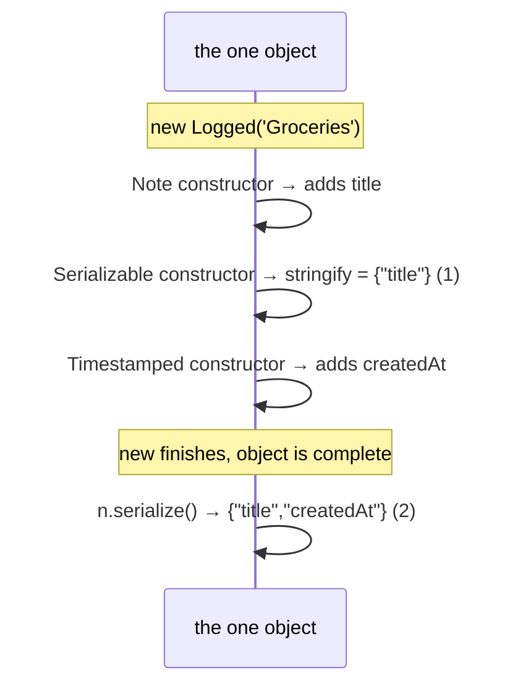

# Instructor Notes — Recurring Mistakes

The instructor logs recurring mistakes here and revisits them during
quizzes and reviews. Format:

```
## YYYY-MM-DD — module/exercise
**Mistake:** what happened (the misconception, not just the code)
**Correction:** the right mental model
**Status:** open | improving | overcome
```

---

## 2026-08-10 — 01/ex02

**Mistake:** Used `||` to supply a fallback for possibly-missing values
(`items[0] || fallback`, `text?.length || 0`). `||` falls back on _any_
falsy value (`''`, `0`, `false`), not just `null`/`undefined`.
**Correction:** Use `??` (nullish coalescing) when the intent is "only if
null or undefined". `[''][0] || 'x'` returns `'x'` — a wrong answer;
`[''][0] ?? 'x'` returns `''` — correct.
**Recurred 2026-08-26 — 03/checkpoint:** proposed `...(overrides.debug && { debug: overrides.debug })` to guard a spread. `&&` short-circuits on `false`, so `{ debug: false }` was silently ignored. Same root idea: _falsy ≠ missing_. Guard on presence (`!== undefined` / `in`), not truthiness.
**Recurred 2026-08-28 — 04/ex02:** branched on an optional parameter with
`if (end)`, so `range(2, 0)` took the "no second argument" path and returned
`[0, 1]` instead of `[]`. Third sighting of _falsy ≠ missing_, now in the
optional-parameter setting. The test suite did not cover a falsy argument;
cases were added. Question to ask when branching on an optional: "am I
asking whether it was **passed**, or whether it is **truthy**?" — for
optionals it is always the former, so `!== undefined`.
**Good sign 2026-09-05 — 04/checkpoint:** gave `pad` a default parameter
(`char = ' '`) instead of `char || ' '`, so the explicit `''` argument was
honored. Defaults fire only on `undefined` — the right tool.
**Recurred same day:** a follow-up edit replaced the default with
`char || ' '`, which turned the explicit `''` into a space and broke the
test. The default had been chosen without the reasoning behind it. Quiz
target: "default parameter asks _passed?_, `||` asks _truthy?_".
**Status:** open


