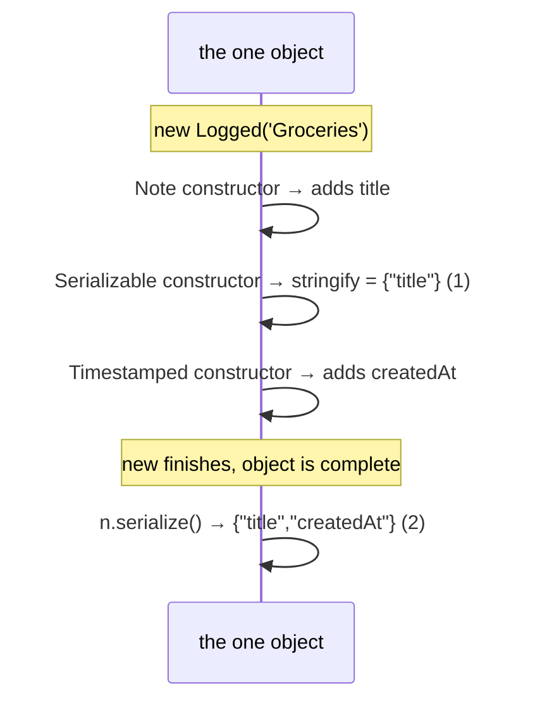

# Instructor Notes — Recurring Mistakes

The instructor logs recurring mistakes here and revisits them during
quizzes and reviews. Format:

```
## YYYY-MM-DD — module/exercise
**Mistake:** what happened (the misconception, not just the code)
**Correction:** the right mental model
**Status:** open | improving | overcome
```

---

## 2026-10-10 — 06/ex07

**Mistake:** Marked the mixin's `createdAt` as `private`, though the spec
says the mixin _adds_ it for callers to read. `private` blocks every read
from outside the class (TS2341), so `n.createdAt` failed to compile.
Second modifier mix-up this module: ex01 first used `protected` where
`readonly` was meant (commit 7994926).
**Correction:** Choose a modifier by asking two questions: _who may read
it?_ (everyone → no visibility modifier; subclasses → `protected`; this
class only → `private`) and _may it change after construction?_ (no →
`readonly`). Visibility and mutability are separate axes, so a public,
never-reassigned field is `readonly`. Fixed to `readonly createdAt`. ✅
**Follow-up (06/checkpoint, 2026-10-17):** Expected `readonly shapes: T[]`
to stop outsiders pushing; it only blocks reassignment. Then put
`readonly T[]` on the field itself and found the class couldn't push
either. Learned the split: `readonly` on a _property_ locks reassignment,
`readonly T[]` on a _type_ locks contents (for everyone), and "read-only
for outsiders" = private mutable `#field` + getter returning `readonly T[]`.
Fixed it on its own after a nudge. ✅
**Status:** improving

## 2026-09-07 — 05/checkpoint

**Mistake:** Wrote a guard as `value is String` (capital S). Read `String`
as "the string type", but it is the _wrapper object_ interface (what
`new String('x')` produces). A primitive `string` is assignable to `String`,
never the other way, so a value narrowed to `String` cannot be passed where
`string` is required. Harmless here only because the assertion signature,
not the guard, did the real narrowing.
**Correction:** The five primitive types are always lowercase: `string`,
`number`, `boolean`, `symbol`, `bigint`. Capitalized `String` / `Number` /
`Boolean` / `Object` are legacy wrapper interfaces and should not appear
in annotations. Rule: if it matches a `typeof` result, it is lowercase.
**Status:** open

## 2026-08-28 — 04/ex01

**Mistake:** To give `applyOp` the type `ApplyOp`, wrote
`function applyOp<ApplyOp>(a, b, op)`. Read the angle brackets as "this
function has type `ApplyOp`". They do the opposite: `<T>` _declares_ a new
generic type parameter, which shadowed the alias of the same name and left
every parameter implicitly `any`. Also assumed `op` was a `string` to
`switch` on, rather than the function itself.
**Correction:** A function type alias annotates a **value**, so it lives on
a `const`, a parameter, or a return type — `const applyOp: ApplyOp = ...`.
There is no syntax to hang an alias on a `function` declaration; those
annotate each parameter inline. Angle brackets after a name always mean
"introduce a type variable" (module 07), never "apply a type".
**Status:** open

## 2026-08-11 — 02/ex05

**Mistake:** Used `as Direction` on each value of a lookup map to make the
return type fit. `as` is an _assertion_ — it tells the compiler to trust
you and widens the literal to the whole union, so a wrong mapping
(`north: 'north' as Direction`) compiles silently.
**Correction:** Prefer letting the compiler _check_ instead of asserting:
`as const` keeps the values as literal types, and literals are verified
assignable to the union at the return site. Rule of thumb: `as const`
narrows and stays checked; `as SomeType` overrides the checker.
**Recurred 2026-09-07 — 05/ex08:** inside `assertIsUser`, cast the
unvalidated input with `value as User` _before_ checking it, then only
tested `!== undefined`. Casting to the target type made the fields look
already-typed, so the `typeof` checks that actually prove the claim got
skipped and `{ name: 42, age: 36 }` slipped through. Rule: inside a
guard/assertion, cast only to something honest like
`Record<string, unknown>`; the narrowing to `User` is what the
_signature_ earns, not what a cast grants.
**Recurred 2026-08-22 — 02/ex08:** first attempt annotated or cast every
line (`: string`, `: readonly [1,2,3]`, `as {...}[]`) in an exercise that
forbids annotations. Corrected quickly once prompted: `let` to widen,
`as const` to narrow, drop return annotations and let the body infer.
Quiz target: "inputs are annotated, outputs are inferred."
**Status:** open

## 2026-08-10 — 01/ex02

**Mistake:** Used `||` to supply a fallback for possibly-missing values
(`items[0] || fallback`, `text?.length || 0`). `||` falls back on _any_
falsy value (`''`, `0`, `false`), not just `null`/`undefined`.
**Correction:** Use `??` (nullish coalescing) when the intent is "only if
null or undefined". `[''][0] || 'x'` returns `'x'` — a wrong answer;
`[''][0] ?? 'x'` returns `''` — correct.
**Recurred 2026-08-26 — 03/checkpoint:** proposed `...(overrides.debug && { debug: overrides.debug })` to guard a spread. `&&` short-circuits on `false`, so `{ debug: false }` was silently ignored. Same root idea: _falsy ≠ missing_. Guard on presence (`!== undefined` / `in`), not truthiness.
**Recurred 2026-08-28 — 04/ex02:** branched on an optional parameter with
`if (end)`, so `range(2, 0)` took the "no second argument" path and returned
`[0, 1]` instead of `[]`. Third sighting of _falsy ≠ missing_, now in the
optional-parameter setting. The test suite did not cover a falsy argument;
cases were added. Question to ask when branching on an optional: "am I
asking whether it was **passed**, or whether it is **truthy**?" — for
optionals it is always the former, so `!== undefined`.
**Good sign 2026-09-05 — 04/checkpoint:** gave `pad` a default parameter
(`char = ' '`) instead of `char || ' '`, so the explicit `''` argument was
honored. Defaults fire only on `undefined` — the right tool.
**Recurred same day:** a follow-up edit replaced the default with
`char || ' '`, which turned the explicit `''` into a space and broke the
test. The default had been chosen without the reasoning behind it. Quiz
target: "default parameter asks _passed?_, `||` asks _truthy?_".
**Status:** open


