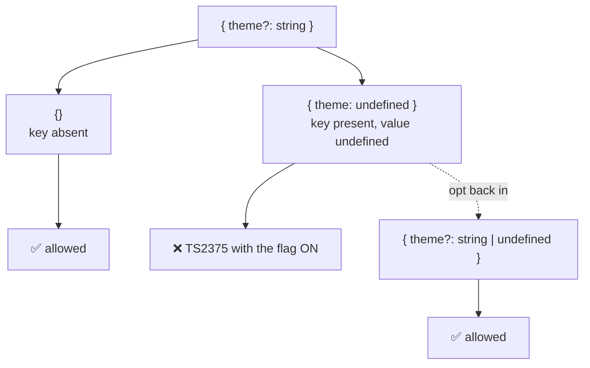
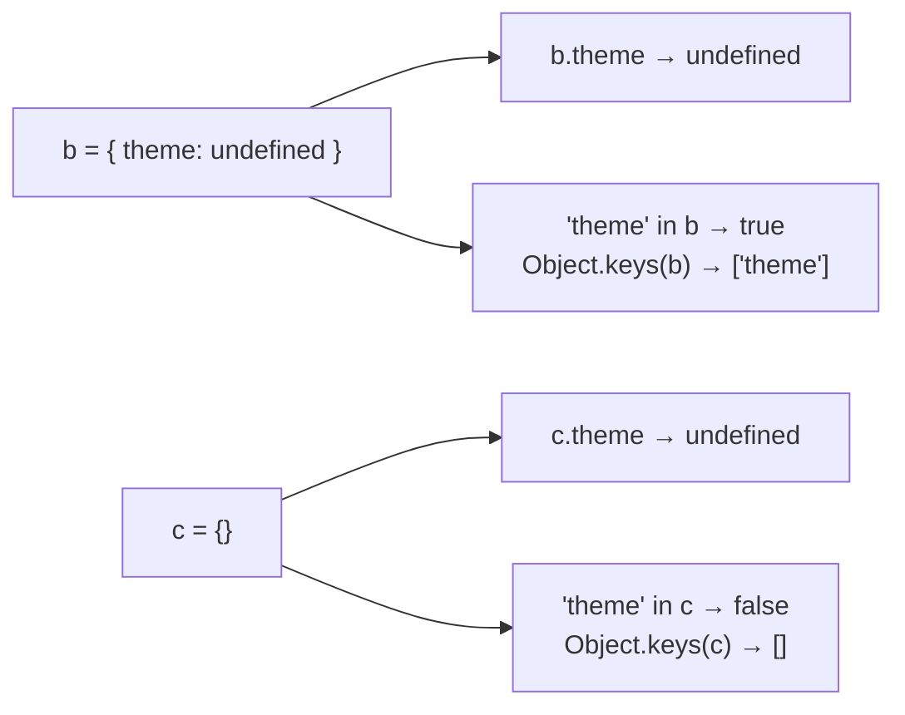

# 01 — Missing vs set to `undefined` (`exactOptionalPropertyTypes`)

Demo: `npm run playground exact-optional-undefined`

This expands the `exactOptionalPropertyTypes` section of
`01-setup-tooling/LESSON.md`.

An object can lack a key in two ways. The key can be **absent**, or it can
be **present with the value `undefined`**. Reading `obj.theme` gives
`undefined` both times, so they look the same. They aren't.

*Caption: with the flag on, `?` means "may be absent" and nothing more.
If you also want "may hold `undefined`", say so with `| undefined`.*

## Who can tell the difference?

*Caption: a plain read can't tell them apart, but `in`, `Object.keys`,
spreading and `JSON.stringify` can. That's why the compiler keeps them apart.*

## Cheat sheet

| Type | `{}` | `{ theme: undefined }` | `{ theme: 'dark' }` |
| --- | --- | --- | --- |
| `{ theme?: string }` (flag ON) | ✅ | ❌ TS2375 | ✅ |
| `{ theme?: string \| undefined }` | ✅ | ✅ | ✅ |
| `{ theme: string \| undefined }` | ❌ key required | ✅ | ✅ |
| `{ theme?: string }` (flag OFF) | ✅ | ✅ | ✅ |

## Gotchas

- `b.theme === c.theme` is `true`. If you only ever *read* the value,
  the difference won't bite. It bites when code checks *keys*.
- Spreads copy present keys. `{ ...defaults, ...{ theme: undefined } }`
  overwrites a real default with `undefined`. The flag stops you building
  that object by accident.
- The flag is **not** part of `strict`. This course turns it on
  separately in `tsconfig.json`.
