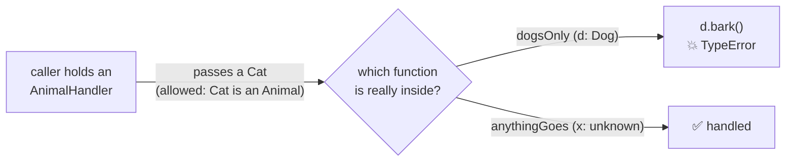
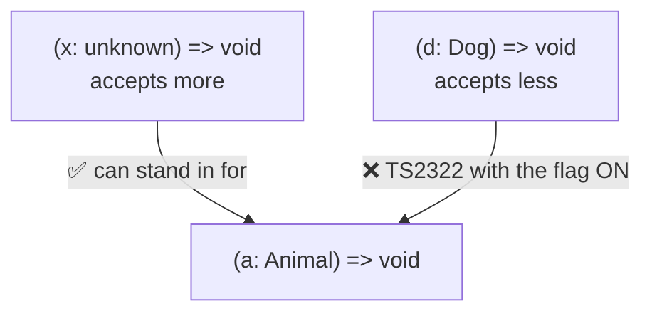

# 01 — A handler must accept at least what its type promises (`strictFunctionTypes`)

Demo: `npm run playground strict-function-types`

This expands the `strictFunctionTypes` section of
`01-setup-tooling/LESSON.md`.

`type AnimalHandler = (a: Animal) => void` is a promise to the caller:
"you may hand me **any** `Animal`." A function that only copes with
`Dog` can't keep that promise.

*Caption: the caller only knows the type, so it can pass any `Animal`.
Only a function whose parameter is **at least as wide** as `Animal` is safe inside.*

## Which direction is allowed?

*Caption: for parameters, wider is safe and narrower is not. That's the
reverse of normal values, where `Dog` can stand in for `Animal`.*

## Cheat sheet

| Assign to `(a: Animal) => void` | Param is… | Flag ON | Why |
| --- | --- | --- | --- |
| `(a: Animal) => …` | same | ✅ | exact match |
| `(x: unknown) => …` | wider | ✅ | handles everything an `Animal` could be |
| `(d: Dog) => …` | narrower | ❌ TS2322 | a `Cat` could arrive |
| `(d: Dog) => …` + `as AnimalHandler` | narrower | compiles | you silenced the check; crash at runtime |

## Gotchas

- The demo's `as AnimalHandler` simulates the flag being off. Any `as` on
  a function type can bring back the crash, even with the flag on.
- **Method** syntax in an interface (`handle(a: Animal): void`) is still
  checked the old, loose way, even with the flag on. Property syntax
  (`handle: (a: Animal) => void`) gets the strict check. Module 08 covers why.
- The theory name is *contravariance*. You don't need the word yet, only
  the rule: a handler must accept at least what its type promises.
