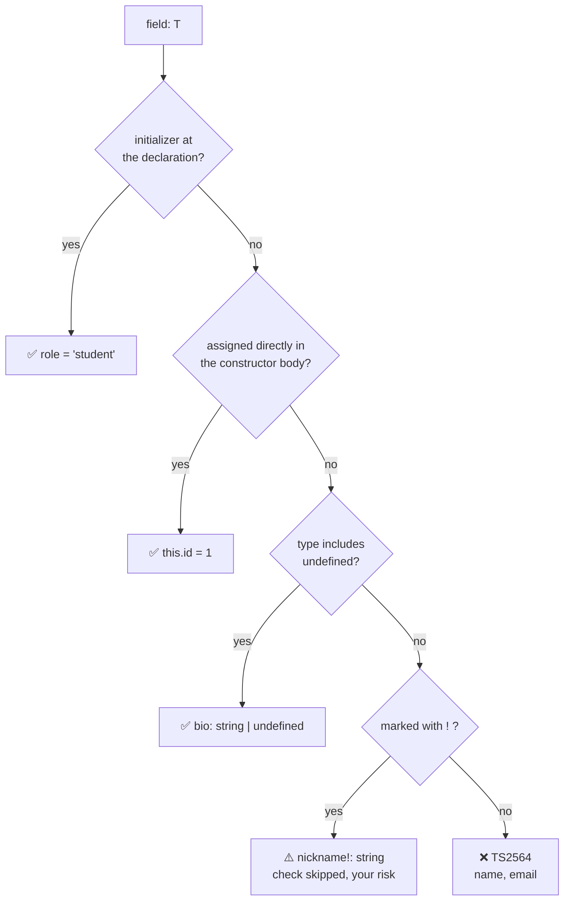

# 01 — No half-built objects (`strictPropertyInitialization`)

Demo: `npm run playground strict-property-init`

This expands the `strictPropertyInitialization` section of
`01-setup-tooling/LESSON.md`.

A field typed `name: string` is a promise: every `User` has a string
`name`. If the constructor can finish without setting it, the object
holds `undefined` while its type says `string`. The flag refuses to
compile that.

*Caption: the compiler asks these four questions in order. A field that
answers "no" to all four is an error.*

## What the run shows

| Field | How it's handled | Compiles? | Runtime value |
| --- | --- | --- | --- |
| `name: string` | never assigned | ❌ TS2564 | `undefined` (the lie) |
| `email: string` | assigned in `init()` | ❌ TS2564 | `"a@b.com"` |
| `role: string = "student"` | initializer | ✅ | `"student"` |
| `id: number` | constructor body | ✅ | `1` |
| `nickname!: string` | `!` assertion | ✅ | `undefined` (the lie, now silent) |
| `bio: string \| undefined` | `undefined` in the type | ✅ | `undefined` (honest) |

## Gotchas

- `email` really is set at runtime. The compiler doesn't look inside
  `this.init()`, so it can't prove it. Assign in the constructor, or
  have `init()` return the value: `this.email = this.makeEmail()`.
- `!` doesn't set anything. It only switches the check off. `nickname`
  is still `undefined`, and nothing warns you.
- `bio` and `nickname` print the same value. The difference is the
  type: `bio` admits it might be `undefined`, so callers must check.
