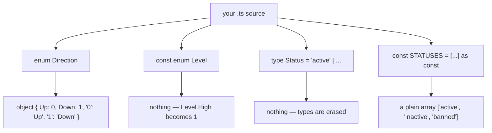
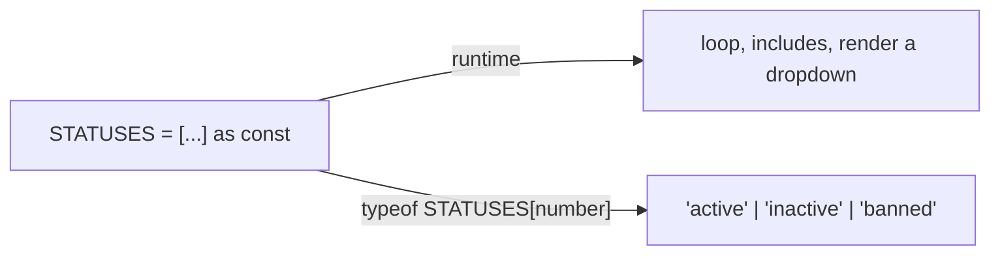

# 02 — Enum vs `const enum` vs literal union vs `as const` array

Demo: `npm run playground enums-vs-alternatives`

This expands the `Enum vs const enum vs literal union vs as const object`
section of `02-basics/LESSON.md`. It came up during ex01.

Most TypeScript types vanish when the code runs. Enums are the odd one
out. A regular enum compiles to a real object.

So the real question is: **what is left at runtime?** That decides what
you can log, loop over, or check against.



*Caption: only the regular enum and the `as const` array survive to runtime.
`const enum` and the literal union leave nothing behind.*

## The modern pattern: one list, two uses



*Caption: write the values once as an `as const` array. Derive the type from
it. You get a runtime list **and** a precise type, with no duplication.*

The demo prints:

```text
enum object: { '0': 'Up', '1': 'Down', Up: 0, Down: 1 }
reverse mapping: Up
enum key: 0
enum key: 1
enum key: Up
enum key: Down
string enum object: { Red: 'RED', Blue: 'BLUE' }
const enum member: 1
```

Note the four keys for a two-member numeric enum. That's the reverse mapping.

## Cheat sheet

| | Runtime object? | Reverse map (`X[0]`)? | Iterate it? | Typo caught? |
| --- | --- | --- | --- | --- |
| numeric `enum` | ✅ | ✅ | ✅ but keys are doubled | ✅ |
| string `enum` | ✅ | ❌ TS2551 on `Color["RED"]` | ✅ | ✅ |
| `const enum` | ❌ inlined | ❌ TS2476 on `Level[1]` | ❌ TS2475 on `Level` | ✅ |
| literal union | ❌ | — | ❌ | ✅ TS2820 "Did you mean…" |
| `as const` array + derived type | ✅ plain array | — | ✅ clean | ✅ |

## Gotchas

- `Object.keys(Direction)` on a numeric enum gives `"0", "1", "Up", "Down"`.
  Filter the numeric keys out, or use a string enum.
- `const enum` is erased. `Level.High` becomes the number `1` in the
  output, so there is no `Level` object to log or loop over.
- `STATUSES.includes(x)` only accepts the literal union. Passing a plain
  `string` is TS2345. That's why the demo writes `"banned" as Status2`.
