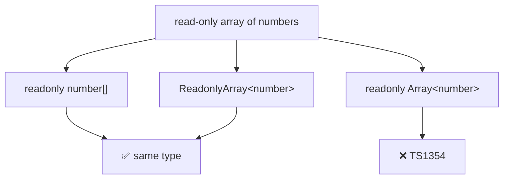
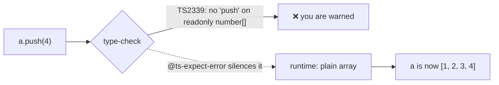

# 02 — Two spellings of a readonly array

Demo: `npm run playground readonly-spellings`

This expands the `Readonly arrays` section of `02-basics/LESSON.md`.
It came up during ex03.

There are two ways to write "an array you can't change".
`readonly number[]` and `ReadonlyArray<number>` mean exactly the same thing.

There is no third spelling. `readonly Array<number>` is an error.
The `readonly` keyword only attaches to the bracket syntax.



*Caption: `readonly` is a modifier for `T[]` and tuple syntax.
For the generic form, use the separate `ReadonlyArray<T>` type.*

## `readonly` exists only for the compiler



*Caption: `readonly` is erased. If you silence the error, the push really
happens. The type system was the only guard.*

The demo silences both errors on purpose, then prints:

```text
a after push -> [ 1, 2, 3, 4 ]
b after push -> [ 1, 2, 3, 4 ]
c (plain array at runtime) -> [ 1, 2, 3 ]
```

## Cheat sheet

| Spelling | Valid? | `.push` / `[i] =` | `.map` / `.slice` | At runtime |
| --- | --- | --- | --- | --- |
| `readonly number[]` | ✅ | ❌ TS2339 | ✅ (return new arrays) | plain array |
| `ReadonlyArray<number>` | ✅ | ❌ TS2339 | ✅ | plain array |
| `readonly Array<number>` | ❌ TS1354 | — | — | — |
| `number[]` | ✅ | ✅ | ✅ | plain array |

## Gotchas

- `readonly` is shallow. A `readonly User[]` stops `push`, but you can
  still change `users[0].name`.
- Need a runtime guard too? `Object.freeze(arr)` makes `push` throw
  ("object is not extensible"). Its return type is already `readonly T[]`.
- A `number[]` can be passed where `readonly number[]` is expected. Not the
  other way round. Take `readonly` parameters when you don't mutate.
