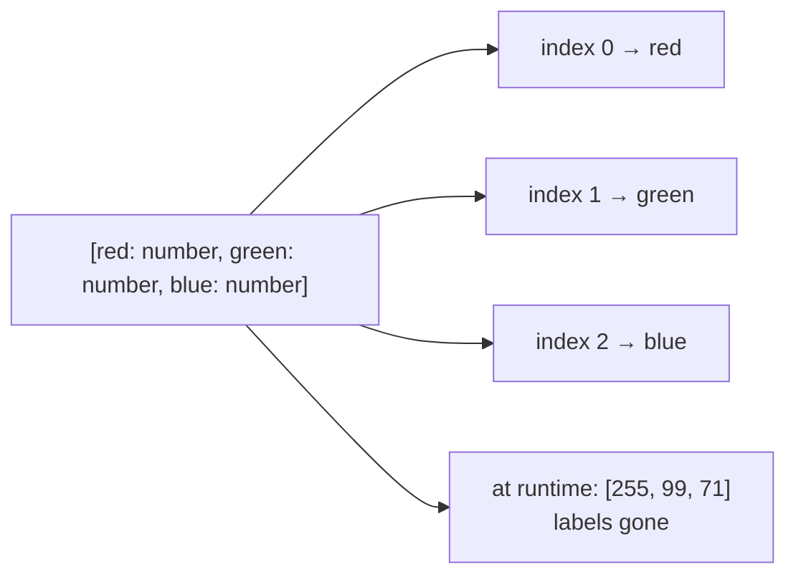
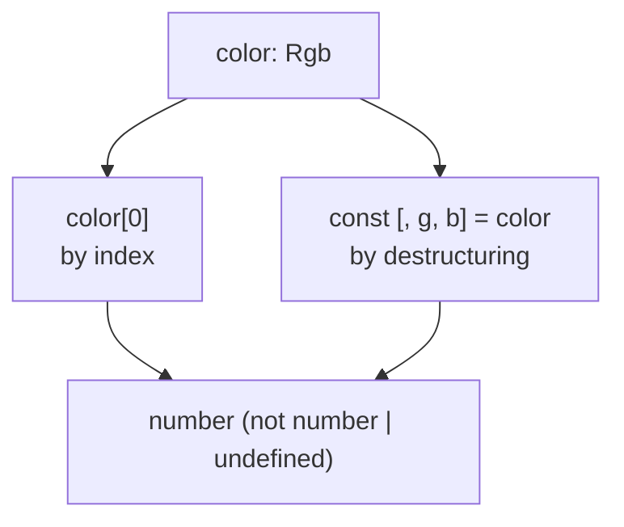

# 02 — Tuples: fixed length, one type per position

Demo: `npm run playground tuples-demo`

This expands the `Named tuple members and readonly tuples` and
`Destructuring tuples` sections of `02-basics/LESSON.md`. It came up during ex03.

An array says "many of one thing". A tuple says "exactly these things,
in this order". `Rgb` is three numbers: red, then green, then blue.

The labels (`red:`, `green:`, `blue:`) are documentation. They show up in
editor hints. They don't exist at runtime.

*Caption: a tuple is an array whose length and per-position types are known.
The labels help humans; the runtime only sees an array.*

## Two ways to read a tuple

*Caption: both ways give a plain `number`. The tuple's fixed length means
`noUncheckedIndexedAccess` doesn't add `| undefined` for in-range indexes.*

The demo prints `brightness: 141.66666666666666`, the average of `255, 99, 71`.

## Cheat sheet

| Write this | Result | Why |
| --- | --- | --- |
| `const t: Rgb = [255, 99, 71]` | ✅ | three numbers, right order |
| `const t: Rgb = [255, 99]` | ❌ TS2322 "Source has 2 element(s) but target requires 3" | too short |
| `const t: Rgb = [255, 99, 'x']` | ❌ TS2322 on `'x'` | wrong type at position 2 |
| `const t = [1, 2]` | `number[]`, not a tuple | inference picks arrays |
| `t.push(4)` on `Rgb` | ✅ compiles (!) | mutable tuples keep array methods |
| `rt.push(3)` on `readonly [number, number]` | ❌ TS2339 | readonly removes them |

## Gotchas

- A plain tuple still has `push`. The compiler won't stop `t.push(4)`.
  Use `readonly [..]` when the length really must stay fixed.
- Tuple literals infer as arrays. Annotate, or use `as const`, to keep the tuple.
- The demo writes the full tuple type in `brightness`'s parameter. Reusing
  `Rgb` there is shorter and keeps the two in sync.
