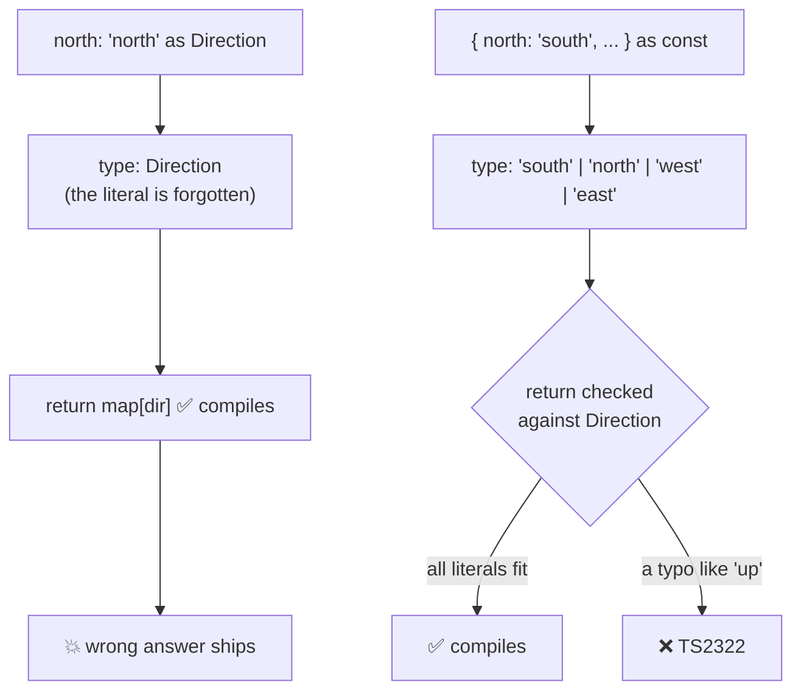

# 02 — `as Direction` vs `as const`: assertion vs checked literal

Demo: `npm run playground opposite-review`

This expands the `as const vs as T — narrows-and-checks vs overrides`
section of `02-basics/LESSON.md`. It came from the review of ex05 (`opposite`).

Both versions build a lookup map and compile cleanly. Only one of them
is actually checked.

`'north' as Direction` is an **assertion**. It tells the compiler "trust me,
this is a `Direction`". The compiler stops asking whether it's the *right* one.

`as const` does the opposite. It keeps each value as its exact literal.
Then the `return` is checked against `Direction` for real.



*Caption: `as T` overrides the compiler. `as const` narrows, and the
compiler still checks the narrowed type where it's used.*

The demo prints:

```text
A says opposite of north is: north
B says opposite of north is: south
```

Version A maps `north` to `north`. It compiled anyway.

## Cheat sheet

| You write | Type of the value | Typo `'up'` caught? | Wrong-but-valid `'north'` caught? |
| --- | --- | --- | --- |
| `'up' as Direction` | `Direction` | ❌ compiles (string overlaps) | ❌ |
| `42 as Direction` | — | ❌ TS2352 "may be a mistake" | — |
| `{ ... } as const`, then `return map[dir]` | exact literals | ✅ TS2322 at the return | ❌ no type can know your intent |
| `{ ... } satisfies Record<Direction, Direction>` | checked object | ✅ | ❌ |

## Gotchas

- `as` only refuses conversions with no overlap (TS2352). Any string
  literal "overlaps" a string union, so `'up' as Direction` sails through.
- No type catches a valid-but-wrong mapping (`north → north`). That's what
  ex05's tests are for. Types and tests guard different things.
- Rule of thumb: reach for `as const` or an annotation first.
  Use `as T` only when you know something the compiler can't.
