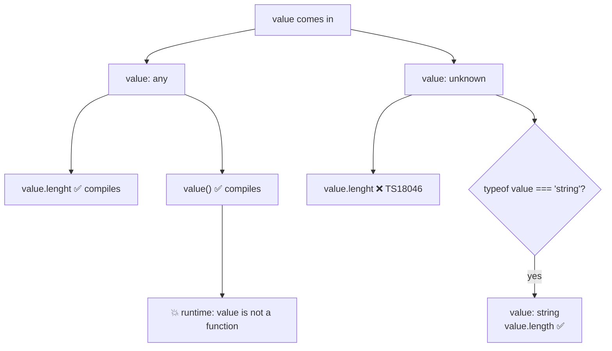

# 02 — `any` vs `unknown`: trust me vs prove it

Demo: `npm run playground any-vs-unknown`

This expands the `any vs unknown` and `Narrowing unknown` sections of
`02-basics/LESSON.md`. It came up during ex06 (`describeValue`).

Both types accept any value. The difference is what you may **do** with it.

`any` turns checking off. Typos, wrong calls, anything goes.
`unknown` keeps checking on. You must prove the type before you use it.



*Caption: `any` lets the bug through to runtime. `unknown` stops it at
compile time until a check narrows the type.*

## Expected output

The demo has **one intentional type error**:

```text
error TS18046: 'value' is of type 'unknown'.
```

That's `value.lenght` inside `withUnknown`. Then it runs anyway and prints:

```text
withAny value.lenght -> undefined
withAny crashed -> value is not a function
withUnknown value.length -> 3
```

`withAny` compiled with two bugs. The typo gave `undefined`. The call crashed.

## Cheat sheet

| | `any` | `unknown` |
| --- | --- | --- |
| Accepts any value | ✅ | ✅ |
| Read a property | ✅ unchecked | ❌ TS18046 |
| Call it | ✅ unchecked | ❌ TS18046 |
| Assign to `string` | ✅ silently | ❌ TS2322 |
| After `typeof x === 'string'` | `string` (checking back on) | `string` |
| Use it for | migrating JS, last resort | outside data: JSON, `catch`, user input |

## Gotchas

- `any` spreads. Pass an `any` into a typed variable and the compiler
  believes it. One `any` can hide bugs far away.
- Narrowing works on both. Inside `if (typeof value === 'string')`, even an
  `any` becomes `string` and typos are caught again.
- `catch (e)` gives `e: unknown` under `strict`. That's why the demo writes
  `(e as Error).message`.
