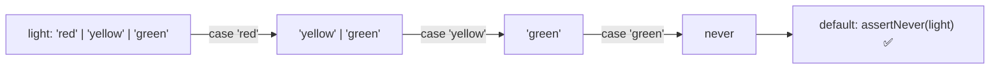
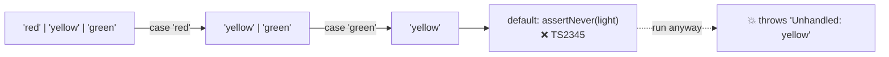

# 02 — Exhaustive switches with `never`

Demo: `npm run playground never-demo`

This expands the `never` section of `02-basics/LESSON.md`.
It came up during ex07 (`assertNever` and `sides`).

`never` is the type with no values. Nothing can ever be assigned to it.

That sounds useless. It's actually a tool. Each `case` in a switch removes
one member from the union. If every member is handled, what's left in
`default` is `never`.



*Caption: every handled case shrinks the type. When nothing is left, the
`default` branch sees `never`, and `assertNever` accepts it.*

## What happens when you forget a case



*Caption: a missed case leaves a real type in `default`. Passing it to a
`never` parameter is a compile error that names the missing case.*

## Expected output

The demo has **one intentional type error**, in `brokenAction`:

```text
error TS2345: Argument of type '"yellow"' is not assignable to parameter of type 'never'.
```

Then it runs anyway and prints:

```text
action('green') -> go
brokenAction('yellow') threw -> Unhandled: yellow
```

## Cheat sheet

| Situation | Type in `default` | `assertNever(x)` |
| --- | --- | --- |
| All cases handled | `never` | ✅ compiles; never runs |
| One case missing | that literal, e.g. `'yellow'` | ❌ TS2345 names it |
| Union grows later (`'blue'` added) | `'blue'` | ❌ TS2345, every switch flags itself |
| Bad data at runtime (types lied) | — | throws, so you notice |

## Gotchas

- The error message is the to-do list. `'"yellow"'` tells you exactly
  which case is missing.
- `assertNever` returns `never`, so `return assertNever(x)` satisfies a
  `string` return type. No dummy return needed.
- Without the `default` branch, a missing case may still be caught by the
  return type (TS2366 "lacks ending return statement"). `assertNever` is
  clearer and also works in functions that return `void`.
