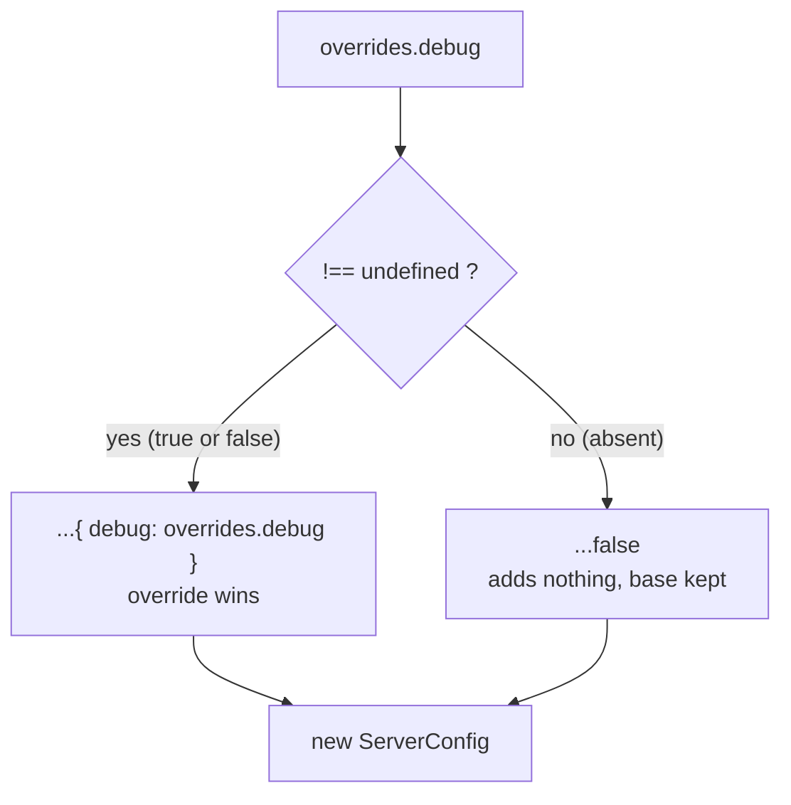

# 03 — Applying optional overrides without losing `false`

Demo: `npm run playground overrides-falsy`

This expands `### Falsy is not missing` and `### Immutable updates with
spread` in `03-objects-interfaces/LESSON.md`, using the checkpoint's
`withOverrides`.

An override is optional. "Not given" must leave the base alone. But
`debug: false` *is* given. It must win.

So the guard asks "is it present?", not "is it truthy?". That means
`!== undefined`.



*Caption: each optional key is copied only when it is really there.
Spreading `false` adds no keys, which is what makes the one-liner work.*

## Three ways to write it

| Version | Code | `{ debug: false }` | `{ env: undefined }` |
| --- | --- | --- | --- |
| Guarded (checkpoint) | `...(o.debug !== undefined && { debug: o.debug })` | `debug: false` ✅ | `env: 'prod'` ✅ kept |
| Truthy guard | `...(o.debug && { debug: o.debug })` | `debug: true` ❌ override lost | `env: 'prod'` |
| Plain spread | `{ ...base, ...o }` | `debug: false` ✅ | `env: undefined` ❌ base wiped |

## What the run shows

```text
guarded, debug: false     -> { host: 'x', port: 80, env: 'prod', debug: false }
guarded, env: undefined   -> { host: 'x', port: 80, env: 'prod', debug: true }
guarded, {}               -> { host: 'x', port: 80, env: 'prod', debug: true }
truthy,  debug: false     -> { host: 'x', port: 80, env: 'prod', debug: true }
naive,   env: undefined   -> { host: 'x', port: 80, env: undefined, debug: true }
spread of false           -> {}
```

## Gotchas

- The type-check shows one ❌ **TS2379** on `withOverrides(base, { env:
  undefined })`. With `exactOptionalPropertyTypes`, `env?:` means "may be
  absent", not "may be `undefined`". That error is intentional.
- So in this course, plain spread is *almost* safe: the compiler blocks
  an explicit `undefined`. Without the flag (most projects), it isn't.
  The demo fakes that with `as unknown as Overrides`.
- The truthy guard compiles cleanly. Nothing warns you that `false`
  gets dropped. Only a test with `false` catches it.
