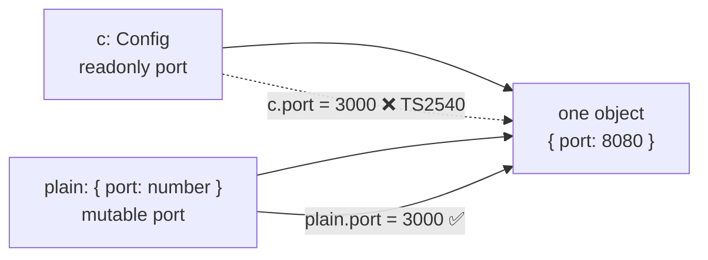

# 03 — `readonly` doesn't survive an alias

Demo: `npm run playground readonly-existant`

This expands `### \`readonly\`: compile-time only, and shallow` in
`03-objects-interfaces/LESSON.md`, prompted by ex02 (`Config` with
readonly `host` and `port`).

`readonly` is a rule about one *type*. It is not a lock on the object.

A `Config` is assignable to a type with a mutable `port`. Assignability
ignores `readonly`. Write through that second name, and the original
object changes.



*Caption: two names, one object. `readonly` only guards the name you
write through. `plain` has no guard, so `c.port` becomes 3000.*

## Both directions compile

| Assignment | Compiles? | Then writing `.port` |
| --- | --- | --- |
| `const plain: { port: number } = c` (readonly → mutable) | ✅ | ✅ allowed, mutates `c` |
| `const y: Config = x` (mutable → readonly) | ✅ | ❌ TS2540 through `y`, still ✅ through `x` |
| `c.port = 3000` directly | — | ❌ TS2540 |

## What the run shows

```text
plain.port -> 3000
c.port     -> 3000 (c is mutated: same object)
c === plain -> true
x.port     -> 3000 (runtime ignores readonly: the write still happened)
```

The type-check reports one ❌ **TS2540**: `Cannot assign to 'port'
because it is a read-only property` on `y.port = 3000`. The write
through `plain` gets no error at all.

## Gotchas

- The last line prints 3000 even though `y.port = 3000` is an error.
  Type errors don't stop `tsx`. `readonly` is erased, so the write runs.
- Want a real runtime lock? `Object.freeze`. It is still shallow.
- This is why ex02 returns new objects with spread instead of trusting
  `readonly` to protect shared data.
