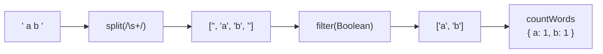

# 03 — Splitting text into words: `split` + `filter(Boolean)`

Demo: `npm run playground ex03__split`

This supports ex03 (`countWords`) under `### Index signatures: when you
don't know the keys` in `03-objects-interfaces/LESSON.md`. The index
signature is the easy part. Getting clean keys out of the text is the
trap.

`split(' ')` splits on exactly one space. Two spaces give an empty
string. Tabs and newlines aren't split at all.

`split(/\s+/)` splits on any run of whitespace. But leading or trailing
whitespace still leaves an empty string at the ends.

`.filter(Boolean)` removes every `''`, because `''` is falsy.

*Caption: the regex handles any whitespace; the filter removes the empty
strings at the edges. Without it, `''` becomes a key in the count.*

## What each tokenizer returns

| Input | `split(" ")` | `split(/\s+/)` | `split(/\s+/).filter(Boolean)` |
| --- | --- | --- | --- |
| `"a b a"` | `['a','b','a']` | `['a','b','a']` | `['a','b','a']` |
| `"a  b"` | `['a','','b']` ⚠️ | `['a','b']` | `['a','b']` |
| `"a\tb\nc"` | `['a\tb\nc']` ⚠️ | `['a','b','c']` | `['a','b','c']` |
| `"  a b  "` | `['','','a','b','','']` ⚠️ | `['','a','b','']` ⚠️ | `['a','b']` |
| `""` | `['']` ⚠️ | `['']` ⚠️ | `[]` |

## Gotchas

- `''.split(/\s+/)` is `['']`, not `[]`. Splitting always returns at
  least one element. Empty input would count one empty word.
- `filter(Boolean)` is safe here because every element is a string.
  The only falsy string is `''`. On numbers it would also drop `0`.
- `text.trim().split(/\s+/)` fixes the edges but still returns `['']`
  for empty input. The filter covers both cases.
