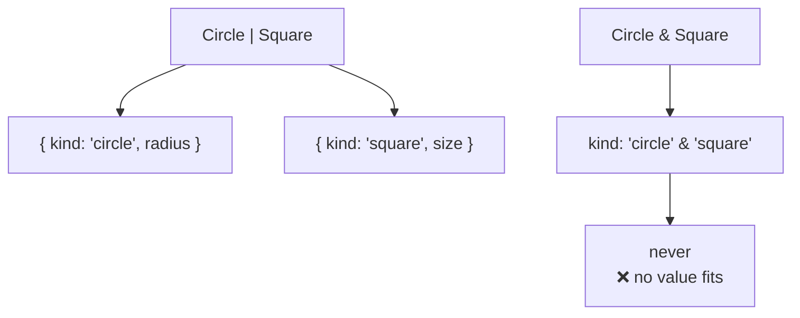

# 03 — `|` vs `&` on object types

Demo: `npm run playground type-union-vs-and`

This expands `### Intersection with \`&\` — and its silent \`never\`` in
`03-objects-interfaces/LESSON.md`, prompted by ex05's `Shape` union.

`Circle | Square` means "one or the other". Each value picks a side.

`Circle & Square` means "both at once". A value would need
`kind: 'circle'` *and* `kind: 'square'`. No string is both.

So `kind` becomes `never`. A required property of type `never` can't
be filled, so the whole type collapses to `never`.



*Caption: a union offers choices. An intersection demands everything at
once; when two `kind` literals clash, nothing is left.*

## Union vs intersection

| | `A \| B` | `A & B` |
| --- | --- | --- |
| A value must be | an `A` or a `B` | an `A` and a `B` |
| Properties you can read without narrowing | only the shared ones (`kind`) | all of them |
| Conflicting `kind` literals | fine — that's the discriminant | whole type becomes `never` |
| Use it for | "one of these shapes" (ex05 `Shape`) | "add fields to a shape" (`Circle2 = { radius } & Shape2`) |

## What the run shows

```text
union values      -> [ { kind: 'circle', radius: 1 }, { kind: 'square', size: 2 } ]
intersection value -> { radius: 5, kind: 'circle', area: 123 }
tried (never)     -> {} (runtime has no idea it is "never")
```

The type-check reports one ❌ **TS2322**: `Type '{}' is not assignable to
type 'never'. The intersection 'Shapes' was reduced to 'never' because
property 'kind' has conflicting types in some constituents.`

## Gotchas

- The error lands where you *use* `Shapes`, not where you declare it.
  `type Shapes = Circle & Square` itself compiles.
- `&` is fine when the parts don't overlap. `Circle2` combines
  `{ radius }` with `{ kind, area }` and works like `extends`.
- An `interface` can't be a union. That is why ex05's `Shape` has to be
  a `type`.
