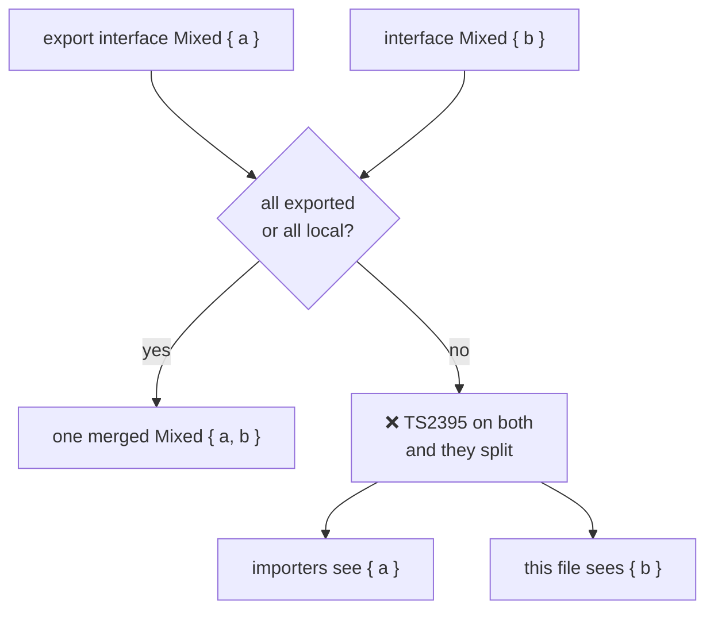

# 03 — Merging needs matching `export`

Demo: `npm run playground export-merge`

This expands `### Declaration merging: two declarations, one interface`
in `03-objects-interfaces/LESSON.md`, prompted by ex06 (two
`export interface AppGlobals` declarations).

In ex06 both declarations say `export`. They merge. Drop `export` from
one, and they no longer merge.

TypeScript reports **TS2395** on both declarations: `Individual
declarations in merged declaration 'Mixed' must be all exported or all
local.`



*Caption: merging only happens between declarations with the same
`export`. A mismatch is an error, and the two halves stay separate.*

## What each side sees

| Where you use `Mixed` | Its shape | Checked how |
| --- | --- | --- |
| Inside this file | `{ b: string }` (local one) | `{ b: 'only b' }` compiles; adding `a` gives TS2353 |
| A file that imports it | `{ a: string }` (exported one) | `{ b: 'b' }` gives TS2353 |
| Both `export` (ex06's fix) | `{ a: string; b: string }` | merged ✅ |

## What the run shows

```text
local -> { b: 'only b' }
```

## Gotchas

- The fix is to make them match: `export` on both (what ex06 does), or
  on neither.
- Interfaces are erased. The runtime output shows nothing about `Mixed`;
  all the action is in the type-check.
