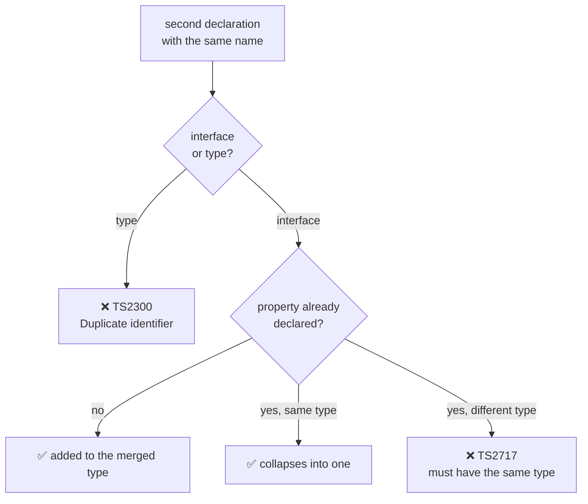

# 03 — The three rules of declaration merging

Demo: `npm run playground merging-rules`

This expands `### Declaration merging: two declarations, one interface`
in `03-objects-interfaces/LESSON.md`, prompted by ex06.

Two `interface` declarations with the same name become one. Members are
collected from both.

If both declare the same property, the types must match. Same type is
fine; it collapses into one property.

A `type` alias never merges. A second one is just a duplicate name.



*Caption: only interfaces merge, and a repeated property must keep its
exact type.*

## The rules

| Case | Code | Result |
| --- | --- | --- |
| 1. Same property, same type | `interface A { id: string }` + `interface A { id: string; name: string }` | ✅ `A = { id; name }` |
| 2. Same property, different type | `interface B { id: string }` + `interface B { id: number }` | ❌ TS2717 |
| 3. `type` declared twice | `type C = {…}` + `type C = {…}` | ❌ TS2300 on both |

## What the run shows

```text
a (merged A) -> { id: '1', name: 'ok' }
```

The file type-checks clean. Each expected error is claimed by a
`// @ts-expect-error` line. Delete one to see the real message, e.g.
`TS2717: Subsequent property declarations must have the same type.
Property 'id' must be of type 'string', but here has type 'number'.`

## Gotchas

- `@ts-expect-error` fails if the next line has *no* error. So this
  file also proves the errors exist.
- Merging is silent. Two `interface User` in the same scope combine
  without a warning. See `ex06__scope-demo.md` for how far "the same
  scope" reaches.
- Methods with the same name don't conflict; they become overloads.
