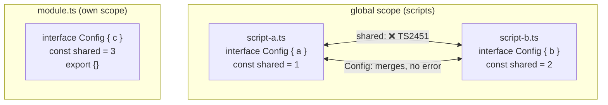

# 03 — Script vs module scope

Demo (folder, type-check only — it is **meant to fail**):

```bash
npx tsc --noEmit --strict --moduleDetection auto playground/03-objects-interfaces/ex06__scope-demo/*.ts
```

This expands `### Declaration merging: two declarations, one interface`
in `03-objects-interfaces/LESSON.md`, prompted by ex06. The folder's own
`README.md` has the same notes in short form.

A file with no top-level `import` or `export` is a **script**. Everything
it declares lands in one shared global scope.

A file with even one `export` (here `export {}`) is a **module**. Its
declarations are private to the file.

So in the two scripts, `const shared` collides. And `interface Config`
merges across files, silently.



*Caption: the two scripts share one global scope, so `const` names
collide and interfaces merge. `module.ts` sits in its own box and
touches neither.*

## What the type-check shows

Exactly two errors, both about `shared`:

```text
script-a.ts(5,7): error TS2451: Cannot redeclare block-scoped variable 'shared'.
script-b.ts(3,7): error TS2451: Cannot redeclare block-scoped variable 'shared'.
```

| File | Has an export? | Scope | `shared` | `Config` |
| --- | --- | --- | --- | --- |
| `script-a.ts` | no | global | ❌ collides | merges with script-b |
| `script-b.ts` | no | global | ❌ collides | merges with script-a |
| `module.ts` | yes (`export {}`) | own | ✅ fine | ✅ stays private |

## Gotchas

- `module.ts` declares `shared` and `Config` too, and is **not** in the
  error list. One `export {}` bought it a private scope.
- `Config` merged across two files with **no error**. Merging is global
  for scripts. That silence is the footgun.
- Delete the `export {}` from `module.ts` and the error count goes to
  three.
- `--moduleDetection auto` is TypeScript's default rule: "has
  import/export → module". The command just spells it out.
- This failure doesn't affect `npm test`. Vitest only type-checks
  `**/*.test.ts`.
