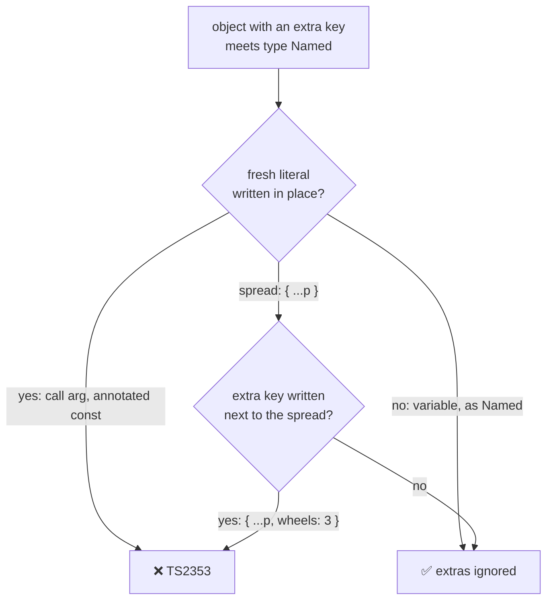

# 03 — When the excess property check fires

Demo: `npm run playground freshness`

This expands `### Excess property checks on fresh literals` in
`03-objects-interfaces/LESSON.md`, prompted by ex07's quiz (`q1` vs `q2`).

Structural typing allows extra properties. A `{ name, age }` is a fine
`Named`.

One exception: a **fresh** object literal, written right where the type
is expected. There, an unknown key is probably a typo, so it's an error
(**TS2353**).

Freshness is lost when the literal is stored in a variable, asserted
with `as`, or spread into a new literal.



*Caption: the check only looks at keys you typed in the literal itself.
Keys that arrive through a variable or a spread aren't checked.*

## The six cases

| # | Code | Fresh? | Compiles? |
| --- | --- | --- | --- |
| 1 | `greet({ name: 'Ada', age: 36 })` | yes | ❌ TS2353 `'age'` (ex07 q1) |
| 2 | `const p = {…}; greet(p)` | no | ✅ (ex07 q2) |
| 3 | `const q: Named = { name: 'Ada', age: 36 }` | yes | ❌ TS2353 `'age'` |
| 4 | `greet({ … } as Named)` | no | ✅ |
| 5 | `greet({ ...p })` | spread keys aren't checked | ✅ |
| 6 | `greet({ ...p, wheels: 3 })` | `wheels` is written out | ❌ TS2353 `'wheels'` |

## What the run shows

```text
1 fresh arg      -> Hello, Ada!
2 via variable   -> Hello, Ada!
3 annotated decl -> { name: 'Ada', age: 36 }
4 assertion      -> Hello, Ada!
5 spread         -> Hello, Ada!
6 spread + extra -> Hello, Ada!
```

Every line runs. The check is compile-time only; the extra key is
harmless at runtime. It exists to catch typos like `{ nmae: 'Ada' }`.

## Gotchas

- Case 3: `q` keeps `age` at runtime, but its type is `Named`. You can
  never read `q.age` without an error.
- `as Named` silences real typos too. Prefer a variable when the extra
  data is on purpose.
- The same check applies to `return` statements: returning a fresh
  literal with an extra key is TS2353 too.
