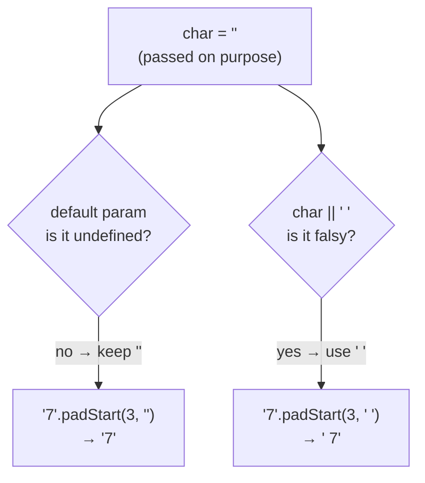

# 04 — Default parameter vs `||` fallback

Demo: `npm run playground cp__default-vs-or`

This expands `### "Was it passed?" vs "is it truthy?"` in
`04-functions/LESSON.md`. It was prompted by the checkpoint's `pad`,
whose `char` defaults to a space.

Two ways to "fall back to a space": a default parameter `char = ' '`, or
an optional `char?` plus `char || ' '`.

They agree when `char` is left out, and when it's `'0'`. They disagree
on exactly one input: the empty string `''`.



*Caption: a default only fires on `undefined`. `||` also throws away
`''`, which may be exactly what the caller asked for.*

## Output

```text
argument left out:
  default -> "  7"
  ||      -> "  7"
argument is "0":
  default -> "007"
  ||      -> "007"
argument is "" (passed on purpose):
  default -> "7"
  ||      -> "  7"
```

## Cheat sheet

| `char` argument | `char = ' '` (default) | `char \|\| ' '` |
| --- | --- | --- |
| left out | `' '` | `' '` |
| `undefined` | `' '` | `' '` |
| `'0'` | `'0'` | `'0'` |
| `''` | `''` (kept) | `' '` (replaced) |

## Gotchas

- `'0'` is a non-empty string, so it's truthy. The number `0` would not be.
- `padStart` with an empty filler returns the text unchanged. That's why
  the default version gives `"7"`.
- The default version also types `char` as plain `string` inside the
  body. The `||` version starts from `string | undefined`.
