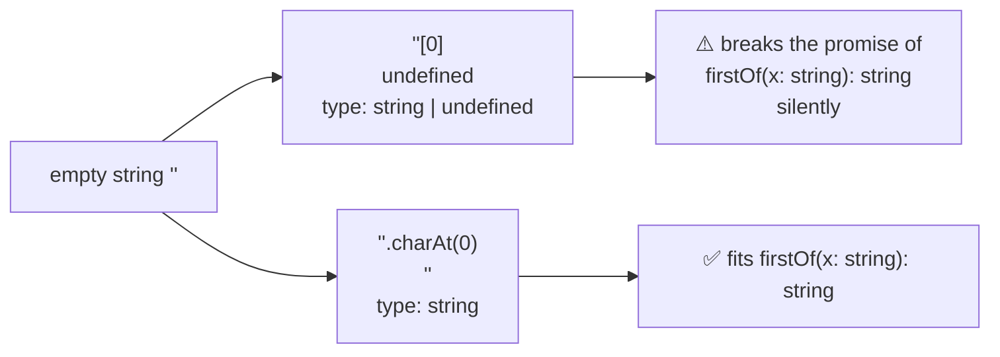

# 04 — Checkpoint review: let the runtime do it

Demo: `npm run playground cp__functions-review`

This came from reviewing `04-functions/checkpoint_04.ts` (`pad`, `joinWith`,
`firstOf`). It best fits `## Common gotchas` in `04-functions/LESSON.md`.

Three small facts about built-in methods. Each one removes a branch you
might write by hand.

1. `padStart` already leaves a string alone when it's long enough. A
   `text.length >= width` guard in `pad` is redundant.
2. `[].join('-')` is already `''`. A `parts.length === 0` guard in
   `joinWith` is redundant.
3. For the first character, `charAt(0)` and `[0]` differ on the empty
   string. That matters for `firstOf('')`.



*Caption: index access may be `undefined`, and `noUncheckedIndexedAccess`
says so in the type. `charAt` always returns a string, so it keeps the
overload's promise.*

Why "silently"? The implementation returns `string | number | undefined`,
and TS checks it only loosely against the overloads. Writing `x[0]` for
the string case compiles with no error, yet `firstOf('')` would return
`undefined` while its type says `string`.

## Output

```text
'1234'.padStart(3, ' ') -> "1234"
[].join('-')           -> ""
''[0]                  -> undefined
''.charAt(0)           -> ""
'abc'.charAt(0)        -> "a"
```

## Cheat sheet

| Expression | Value | Type (course flags) |
| --- | --- | --- |
| `'1234'.padStart(3, ' ')` | `'1234'` | `string` |
| `[].join('-')` | `''` | `string` |
| `s[0]` on `''` | `undefined` | `string \| undefined` |
| `s.charAt(0)` on `''` | `''` | `string` |

## Gotchas

- A redundant guard isn't wrong, just noise. Remove it only when you're
  sure the built-in covers the edge case. The demo proves it does.
- `noUncheckedIndexedAccess` is why `s[0]` is `string | undefined`.
  Without the flag TS would claim `string` and lie for `''`.
- For arrays (`firstOf([])`), `x[0]` is the right call. The overload
  promises `number | undefined`, which matches.
