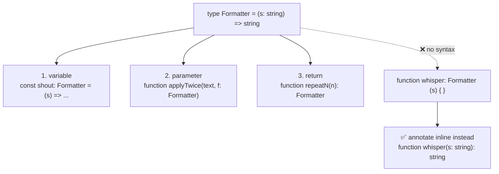

# 04 — Where a function type can go

Demo: `npm run playground ex01__annotating-function-values`

This expands `### How to give a function declaration a type` in
`04-functions/LESSON.md`. It was prompted by exercise 01 (`BinaryOp`,
`applyOp`).

A function type like `type Formatter = (s: string) => string` describes
a function **value**. So it goes wherever a value has a type slot.

There are three such slots: a variable, a parameter, and a return.

A `function` declaration has no such slot. There is no
`function shout: Formatter (s) {}`. You annotate its parameters and
return inline instead.



*Caption: a function type labels a value. A declaration is not a value
slot, so it spells its types out by hand.*

In slots 1 and 3, the arrow's `s` needs no annotation. It is inferred from
the target type. That is contextual typing.

## Output

```text
shout('hi')               -> HI!
applyTwice('hi', shout)   -> HI!!
applyTwice('ab', repeatN(2)) -> abababab
whisper('LOUD')           -> loud
```

`applyTwice('hi', shout)` runs `shout` twice: `HI!` then `HI!!`.

## Cheat sheet

| Slot | Example | Is `s` inferred? |
| --- | --- | --- |
| variable | `const shout: Formatter = (s) => ...` | ✅ from `Formatter` |
| parameter | `f: Formatter` | ✅ when a caller passes an inline arrow: `applyTwice(x, (s) => ...)` |
| return | `function repeatN(n: number): Formatter { return (s) => ... }` | ✅ from the return type |
| declaration | `function whisper(s: string): string` | ❌ you write it |

## Gotchas

- `function whisper<Formatter>(s) {}` does **not** apply the alias. It
  declares a new type parameter named `Formatter`, and `s` is still
  implicitly `any` (TS7006).
- To check a declaration against an alias, assign it afterwards:
  `const checked: Formatter = whisper`.
- In exercise 01, typing `add` as `BinaryOp` is slot 1. That's why its
  `(a, b)` needed no annotations.
