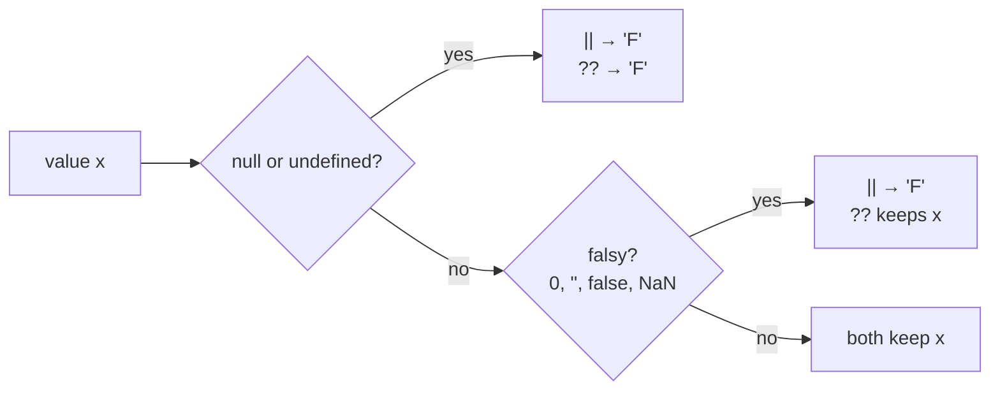

# 04 — `||` vs `??`: which values count as "missing"?

Demo: `npm run playground ex02__falsy-vs-missing`

This expands `### "Was it passed?" vs "is it truthy?"` in
`04-functions/LESSON.md`. It was prompted by exercise 02.

**What only this demo shows:** every interesting value, run through both
operators, in one table. The other ex02 demos look at parameters; this
one looks at the operators themselves.

`x || 'F'` replaces anything **falsy**. That's six values: `undefined`,
`null`, `0`, `''`, `false`, `NaN`.

`x ?? 'F'` replaces only **nullish** values: `undefined` and `null`.



*Caption: `??` is the narrower net. Reach for it unless you really mean
"any falsy value".*

## Output

```text
value      | truthy? | x || "F" | x ?? "F"
-----------|---------|----------|---------
undefined  |   NO    | F        | F
null       |   NO    | F        | F
0          |   NO    | F        | 0
''         |   NO    | F        | 
false      |   NO    | F        | false
NaN        |   NO    | F        | NaN
[]         |   yes   |          | 
{}         |   yes   | [object Object] | [object Object]
'hi'       |   yes   | hi       | hi
```

## Cheat sheet

| Group | Values | `\|\|` | `??` | default param |
| --- | --- | --- | --- | --- |
| nullish | `undefined`, `null` | fallback | fallback | fires on `undefined` only |
| falsy but real | `0`, `''`, `false`, `NaN` | fallback | keeps | keeps |
| truthy | `[]`, `{}`, `'hi'` | keeps | keeps | keeps |

## Gotchas

- `[]` and `{}` are **truthy**. An empty array is not "missing".
- The `[]` row looks blank because `String([])` is `''`. The value was
  kept; it just prints as nothing. Same for the `''` row under `??`.
- `NaN` is falsy but not nullish, so `??` keeps it. Check it with
  `Number.isNaN`, not with either operator.
- A default parameter is stricter than both: `null` does **not** trigger it.
