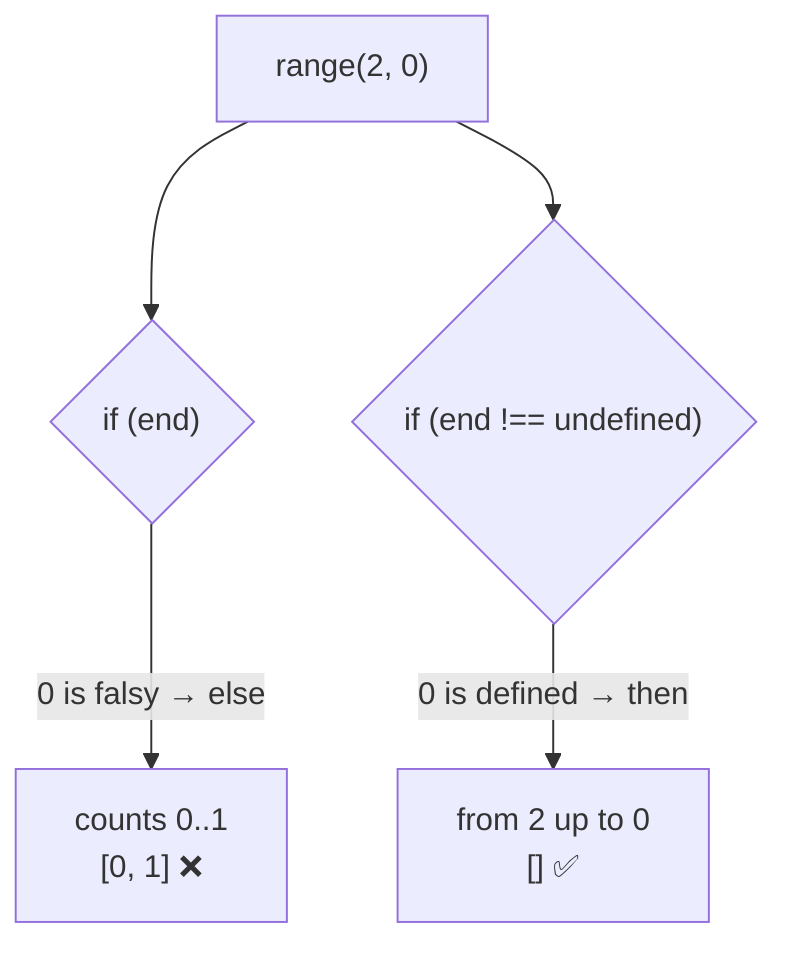

# 04 — Optional `end?`: test for `undefined`, not truthiness

Demo: `npm run playground ex02__optional-vs-default`

This expands `### Default parameters \`= v\`` and
`### "Was it passed?" vs "is it truthy?"` in `04-functions/LESSON.md`.
It was prompted by exercise 02 (`range` and `greet`).

Part 1. `range(start, end?)` must branch on "was `end` passed?". Writing
`if (end)` asks a different question: "is `end` truthy?".

The two agree until `end` is `0`. Then `if (end)` thinks nothing was
passed, and counts `0..start-1` instead.



*Caption: `0` is a real argument. Only `!== undefined` treats it as one.*

Part 2. Does `| undefined` on a defaulted parameter leak into the body?
No. In `greeting: string | undefined = 'Hello'`, the default removes the
`undefined`. Inside the body, `greeting` is plain `string`.

## Output

```text
range(2, 0) truthy: [ 0, 1 ]
range(2, 0) strict: []
Hello, Ada! | Hello, Ada!
```

## Cheat sheet

| Declaration | Callers may omit? | Type inside body |
| --- | --- | --- |
| `end?: number` | ✅ | `number \| undefined` |
| `greeting: string = 'Hello'` | ✅ | `string` |
| `greeting: string \| undefined = 'Hello'` | ✅ | `string` (the default strips `undefined`) |

| Check on `end` | `end` omitted | `end = 0` | `end = 5` |
| --- | --- | --- | --- |
| `if (end)` | else ✅ | else ❌ | then ✅ |
| `if (end !== undefined)` | else ✅ | then ✅ | then ✅ |

## Gotchas

- Hover `g` in `greetA` to see `string`. Verified: assigning it to a
  `string` slot compiles.
- The falsy trap hides with most inputs. Always test the `0`, `''` and
  `false` edge cases.
- See `ex02__falsy-vs-missing` for the full value-by-value table.
