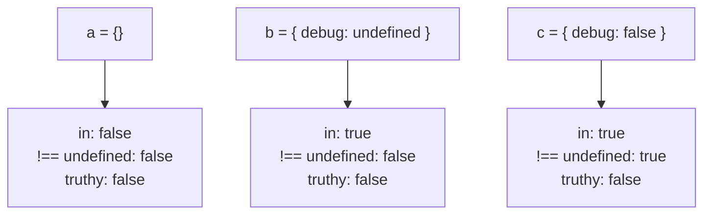

# 04 — "Was it passed?" for object properties

Demo: `npm run playground ex02__presence-on-objects`

This expands `### "Was it passed?" vs "is it truthy?"` in
`04-functions/LESSON.md`. It was prompted by exercise 02, as the object
version of the optional-parameter question.

**What only this demo shows:** the three checks you might use on an
optional **property**, and how each answers for "missing", "set to
`undefined`" and "set to `false`".

`'debug' in s` asks: does the key exist?
`s.debug !== undefined` asks: is there a usable value?
`Boolean(s.debug)` asks: is the value truthy?



*Caption: each object is told apart by a different check. Only `in` sees
`b`'s key; only `!== undefined` sees that `c` holds a real value.*

## Expected type error

`b` is a deliberate error. The course turns on `exactOptionalPropertyTypes`,
so `debug?: boolean` means "may be absent", not "may hold `undefined`":

```text
TS2375: Type '{ debug: undefined; }' is not assignable to type 'Settings' with 'exactOptionalPropertyTypes: true'.
```

The demo runs anyway, so you can see what `b` would do.

## Output

```text
a {}                   in:false !==undefined:false truthy:false
b {debug:undefined}    in:true  !==undefined:false truthy:false
c {debug:false}        in:true  !==undefined:true  truthy:false
```

## Cheat sheet

| Check | `{}` | `{ debug: undefined }` | `{ debug: false }` | Use it for |
| --- | --- | --- | --- | --- |
| `'debug' in s` | false | true | true | does the key exist? |
| `s.debug !== undefined` | false | false | true | "was a value given?" (usual choice) |
| `Boolean(s.debug)` | false | false | false | "is it on?" (only for booleans) |

## Gotchas

- `!== undefined` is the object twin of a default parameter. Both treat
  "missing" and "set to `undefined`" the same.
- A truthy check can't tell "off" from "not set". For a `debug` flag
  that's usually fine; for a count or a string it's a bug.
- Full story on the flag: `01-setup-tooling/lesson__exact-optional-undefined.md`.
