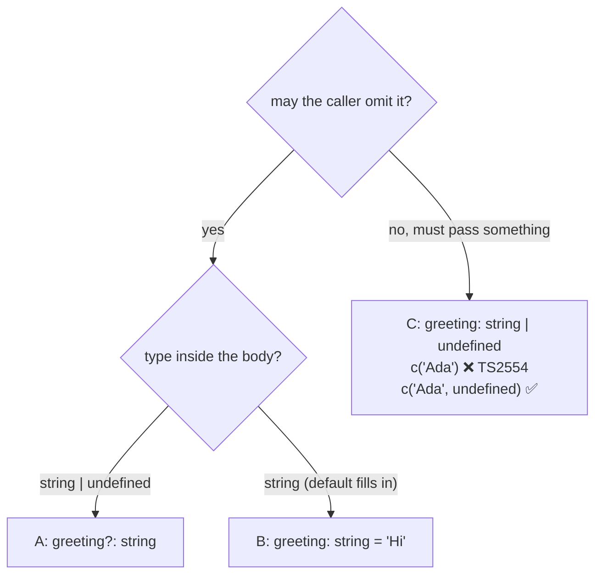

# 04 — Optional, default, or "required but may be `undefined`"

Demo: `npm run playground ex02__three-forms`

This expands `### Optional parameters \`?\`` in `04-functions/LESSON.md`.
It was prompted by exercise 02 (`greet`, `range`).

Three parameter forms look alike. They differ on one question: may the
caller **leave the argument out**?

`greeting?: string` and `greeting = 'Hi'` both say yes.
`greeting: string | undefined` says no. The *value* may be `undefined`,
but the caller must still write it.



*Caption: `?` and `= v` make an argument omittable. `| undefined` only
widens the value; it doesn't make the argument optional.*

## Does a default fire on an explicit `undefined`?

Yes. The demo counts the real arguments with `arguments.length`:

```text
args passed: 1 -> "Hello, Ada!"
args passed: 2 -> "Hello, Ada!"
args passed: 2 -> "Yo, Ada!"
```

Line 2 really passed two arguments. The second was `undefined`, so the
default still fired.

## Cheat sheet

| Form | `f('Ada')` | `f('Ada', undefined)` | Type in body |
| --- | --- | --- | --- |
| A `greeting?: string` | ✅ | ✅ | `string \| undefined` |
| B `greeting: string = 'Hi'` | ✅ | ✅ default fires | `string` |
| C `greeting: string \| undefined` | ❌ TS2554 Expected 2 arguments, but got 1 | ✅ | `string \| undefined` |

## Gotchas

- `c('Ada')` sits under `// @ts-expect-error`, so the demo typechecks
  clean. Delete the comment to see TS2554.
- `exactOptionalPropertyTypes` does not touch parameters. `a('Ada', undefined)`
  is fine even with the flag on. It only applies to object **properties**
  (see `01-setup-tooling/lesson__exact-optional-undefined.md`).
- Use C when you want callers to think about the value every time, even
  if the answer is "nothing".
