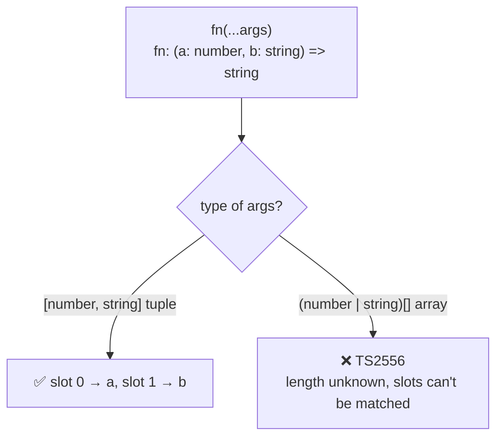

# 04 — Rest parameters and tuple spreads

Demo: `npm run playground ex03__rest-and-tuple-spreads`

This expands `### Tuple rests and spreading into a call` (and
`### Rest parameters`) in `04-functions/LESSON.md`. It was prompted by
exercise 03 (`buildPath`, `callWith`).

Part 1. `buildPath(base, ...segments)` has a trap: with no segments, a
naive join leaves a stray `/`. You can branch on the empty case, or
remove it. Put `base` in the array, and `join('/')` never sees an empty tail.

Part 2. `callWith(fn, args)` spreads `args` into `fn(...args)`. That only
compiles because `args` is a **tuple** `[number, string]`. TS knows its
length and what sits in each slot.



*Caption: an array doesn't know its length, so it can only be spread into
a rest parameter. A tuple does, so it can fill fixed positions.*

## Output

```text
["api"]                  branch=api            join=api            same=true
["api","users"]          branch=api/users      join=api/users      same=true
["api","users","42"]     branch=api/users/42   join=api/users/42   same=true
ababab
```

Both `buildPath` versions agree on every case, including the empty tail.

## Cheat sheet

| `args` passed to `callWith` | Result |
| --- | --- |
| `[3, 'ab']` | ✅ `'ababab'` |
| `['ab', 3]` wrong order | ❌ TS2322 on each element |
| `[3, 'ab', true]` too many | ❌ TS2345 not assignable to `[number, string]` |
| `[3]` too few | ❌ TS2345 not assignable to `[number, string]` |
| an `(number \| string)[]` inside the function | ❌ TS2556 at `fn(...args)` |

| `buildPath` style | Empty tail handled by |
| --- | --- |
| branch: `segments.length > 0 ? '/' + ... : ''` | an explicit `if` |
| join: `[base, ...segments].join('/')` | the shape of the data; no case to forget |

## Gotchas

- Every error above sits under `// @ts-expect-error`, so the demo
  typechecks clean. Remove a directive to see the real message.
- `@ts-expect-error` itself fails if the line **stops** erroring. That
  makes it safer than `@ts-ignore` for demos and tests.
- Rest parameters are always an array, never `undefined`. `segments` is
  `[]` when nothing is passed, so no `?? []` is needed.
