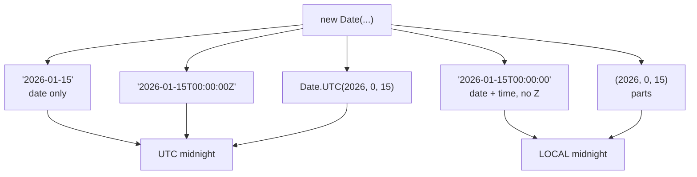

# 04 — Same day, two instants: `Date` from a string vs from parts

Demo: `npm run playground ex04__date-timezone`

This was prompted by exercise 04's `makeDate`, whose two overloads build
a `Date` two ways. It's a runtime JS trap, not a type error. It sits
next to `### Overloads: one function, several contracts` in
`04-functions/LESSON.md`.

`new Date('2026-01-15')` and `new Date(2026, 0, 15)` look like the same
day. They are not the same moment.

A **date-only** ISO string is read as **UTC** midnight. The
`(year, monthIndex, day)` form is **local** midnight. They differ by your
time-zone offset.

Adding a time to the string flips it. `'2026-01-15T00:00:00'` is read as
**local**. Adding `Z` makes it UTC again.



*Caption: pick one column and stay in it. Mixing a UTC form with a local
form gives two different instants for the "same" day.*

## Output (recorded in `America/Chicago`)

```text
TZ = America/Chicago
fromString  2026-01-15T00:00:00.000Z
fromParts   2026-01-15T06:00:00.000Z
equal?      false
hours apart 6

-- string forms --
'2026-01-15'           2026-01-15T00:00:00.000Z <- UTC
'2026-01-15T00:00:00'  2026-01-15T06:00:00.000Z <- LOCAL
'2026-01-15T00:00:00Z' 2026-01-15T00:00:00.000Z <- UTC (explicit)

-- Fix A: both local --
equal? true
-- Fix B: both UTC --
equal? true
```

The "6 hours" is the Chicago offset in January. Your number depends on
your time zone. In UTC it is 0, and the bug hides.

## Cheat sheet

| Input | Read as | Month numbering |
| --- | --- | --- |
| `'2026-01-15'` | UTC | `01` = January |
| `'2026-01-15T00:00:00'` | local | `01` = January |
| `'2026-01-15T00:00:00Z'` | UTC | `01` = January |
| `new Date(2026, 0, 15)` | local | `0` = January |
| `Date.UTC(2026, 0, 15)` | UTC (returns a number) | `0` = January |

## Gotchas

- Months are 0-based in the parts form and 1-based in strings.
- `toISOString()` always prints UTC. `getDate()` and friends read local
  time; `getUTCDate()` reads UTC. Compare like with like.
- Tests that pass on a UTC CI server can fail on your laptop. Run the
  demo with `TZ=UTC` to see the gap vanish.
