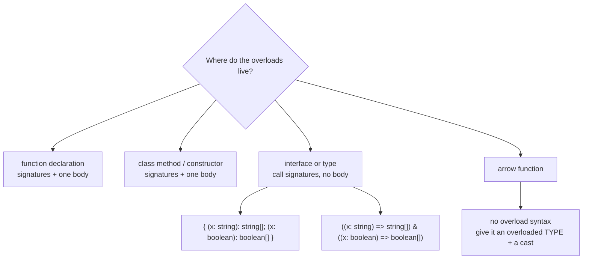

# 04 — Where overloads can be written

Demo: `npm run playground ex04__overload-forms`

This expands `### Overloads in interfaces and on methods` in
`04-functions/LESSON.md`. It was prompted by exercise 04, but uses
different functions.

**What only this demo shows:** the *places* overloads live. The other
demos only use `function` declarations. Here the same idea appears on
classes, interfaces, callable types, intersections and arrows.

Two families exist. With a body, you write signatures then **one**
implementation. Without a body (interfaces and types), you only list
call signatures, and something else must supply the implementation.



*Caption: overload syntax needs a declaration with a name. Arrows have
none, so they borrow an overloaded type instead.*

## Output

```text
{ a: [ 'hi' ], b: [ true ], c: [ 'yo' ], d: [ 'x' ], box: [ 6, 8 ] }
```

`new Box(2)` uses constructor overload 1 (square, `h` defaults to `w`).
`.scale(3, 4)` uses method overload 2. So `[2*3, 2*4]` = `[6, 8]`.

## Cheat sheet

| Form | Syntax | Has a body? |
| --- | --- | --- |
| function declaration | `function f(x: A): R1` ... `function f(x: A \| B) { }` | ✅ one |
| class method / constructor | same pattern inside the class | ✅ one |
| interface member | `parse(input: string): object` repeated | ❌ |
| callable type | `type F = { (x: A): R1; (x: B): R2 }` | ❌ |
| intersection | `((x: A) => R1) & ((x: B) => R2)` | ❌ |
| arrow | `const f: F = ((x: any) => ...) as F` | the arrow, only loosely checked |

## Related demos

| Demo | The one thing it adds |
| --- | --- |
| `ex04__overloads` | the basic before/after, and overloads by arity |
| `ex04__why-overloads` | what you lose with only the implementation signature |
| `ex04__overloads2` | the two rules behind TS2394 and TS2769 |

## Gotchas

- An arrow can't satisfy an overloaded type by itself.
  `const w: Wrap = (x: string | boolean) => [x]` fails with TS2322: its
  single return `(string | boolean)[]` doesn't match either overload. That
  is why the demo casts with `as Wrap`.
- The cast weakens checking. `as` only rejects a body that is clearly
  unrelated (`(x: any) => 42` gets TS2352). A body that returns `x` itself,
  not `[x]`, slips through. Prefer a `function` declaration.
- A declaration with matching overloads satisfies an overloaded type
  directly (`const wrap2: Wrap = wrap`). No cast needed.
