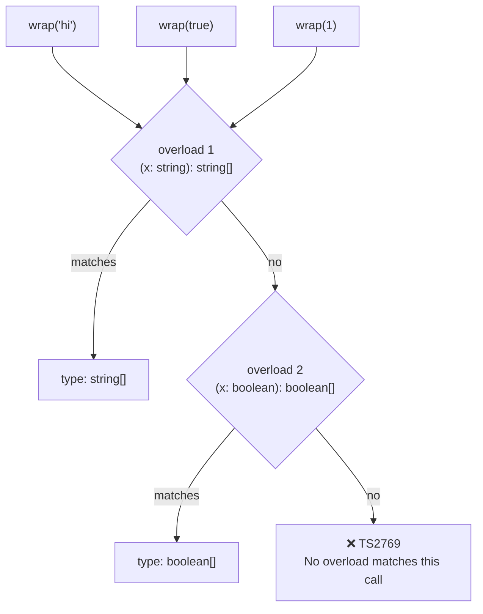
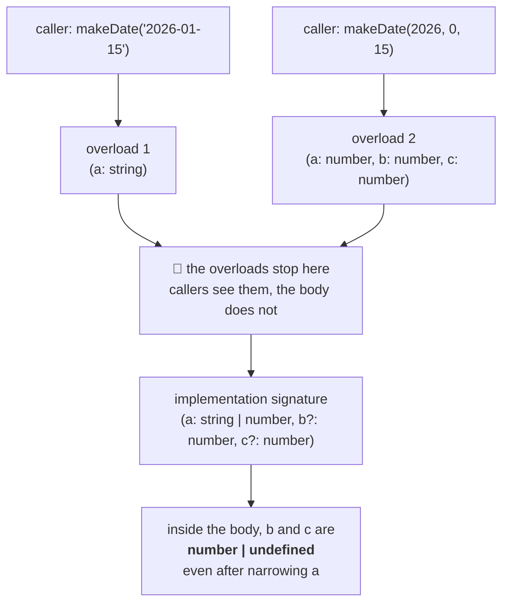

# 04 — What an overload is

Demo: `npm run playground ex04__overloads`

This expands `### Overloads: one function, several contracts` in
`04-functions/LESSON.md`. It was prompted by exercise 04 (`toArray`,
`makeDate`) but uses different functions, so nothing is spoiled.

**What only this demo shows:** the basic before/after. The same body,
first with a union return, then with overloads. Plus overloads that
differ by *how many* arguments, not just their types.

A union return (`string[] | boolean[]`) is true but vague. Every caller
has to narrow it again, even when the argument already told you the answer.

Overloads let each call shape carry its own return type. The caller
passes a `string`, and gets back a `string[]`. No narrowing.



*Caption: the caller's argument picks one overload, top to bottom. That
overload's return type is what the caller gets.*

## The body sees only the implementation



*Caption: overloads are a promise to callers only. Inside the body, TS
knows just the wide implementation signature. So after `typeof a ===
'number'`, `b` is still `number | undefined` and you must check it.*

The demo's `at(x, y?)` is the same situation in miniature. Overload 2
promises `col`, but the body reads `y` as `number | undefined` and has to
test `y === undefined`. Writing `const n: number = b` in that branch
fails with `TS2322: Type 'number | undefined' is not assignable to type 'number'`.

## Output

```text
{ loose: [ 'hi' ], a: [ 'hi' ], b: [ true ], one: 'cell#3', two: 'cell(3,4)' }
```

(Node prints it over several lines.) At runtime `loose` and `a` are the
same array. Only the **types** differ.

## Cheat sheet

| Call | Without overloads (`wrapLoose`) | With overloads (`wrap`) |
| --- | --- | --- |
| `('hi')` | `string[] \| boolean[]` | `string[]` |
| `(true)` | `string[] \| boolean[]` | `boolean[]` |
| `(1)` | ❌ TS2345 | ❌ TS2769 No overload matches |
| `at(3)` / `at(3, 4)` | — | two arities, one name, both `string` |

## Where to go next

| Demo | The one thing it adds |
| --- | --- |
| `ex04__why-overloads` | what you **lose** with only the implementation signature: casts and arity |
| `ex04__overloads2` | the two **rules** that produce TS2394 and TS2769 |
| `ex04__overload-forms` | **where** overloads can be written: classes, interfaces, types, arrows |

## Gotchas

- `wrap(1)` is commented out in the demo. Uncomment it to see `TS2769`.
- The implementation signature is hidden. Callers can't use it, even
  if it would accept their argument.
- `wrapLoose` needs `as string[] | boolean[]` because `[x]` infers
  `(string | boolean)[]`, which is a different type. Overloads avoid
  that: the implementation has no return annotation and the overloads
  only need to be compatible with it.
