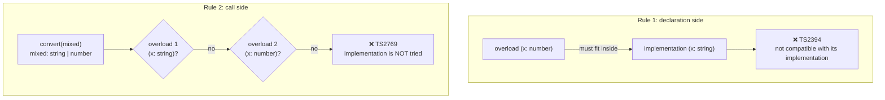

# 04 — The two overload rules (TS2394 and TS2769)

Demo: `npm run playground ex04__overloads2`

This expands `### Overload errors: TS2394 and TS2769` in
`04-functions/LESSON.md`. It was prompted by exercise 04.

**What only this demo shows:** the two errors, side by side, and that
the code still *runs* when they fire. The other overload demos compile
cleanly; this one fails on purpose.

Rule 1. The implementation must accept every overload's parameters.
`parse` promises `(x: number)` in overload 2, but its implementation only
takes `string`. That is **TS2394**, reported on the overload it can't cover.

Rule 2. The implementation signature is not callable. `convert` is
implemented for `string | number`, but no single *overload* takes
`string | number`. So `convert(mixed)` is **TS2769**.



*Caption: TS2394 is about how you **wrote** the overloads. TS2769 is
about how someone **called** them. The implementation signature never
acts as a fallback for callers.*

## Expected type errors

| Line | Code | Message |
| --- | --- | --- |
| `function parse(x: number): string;` | TS2394 | This overload signature is not compatible with its implementation signature. |
| `convert(mixed)` | TS2769 | No overload matches this call. |

## Output

```text
parse("1")   -> 1
convert("42") -> 42 number
convert(42)  -> "42" string
convert(mixed) -> 7 number (runs fine, but TS rejected the call)
```

Type errors don't stop `tsx`. The JS is fine; TS rejected the *contract*.

## Fixes

| Error | Fix |
| --- | --- |
| TS2394 | widen the implementation: `parse(x: string \| number)` |
| TS2769 | add an overload `(x: string \| number): string \| number`, or narrow `mixed` first |

## Related demos

| Demo | The one thing it adds |
| --- | --- |
| `ex04__overloads` | the basic before/after, and overloads by arity |
| `ex04__why-overloads` | what you lose with only the implementation signature |
| `ex04__overload-forms` | where overloads can be written |

## Gotchas

- TS2394 points at the **overload**, not the implementation. Look one
  line down for the real culprit.
- An implementation *wider* than all overloads is fine and silent. Only
  a too-narrow one is caught.
- `mixed` is a real value here (`Math.random() < 2 ? "7" : 7`, always
  `"7"`). A `declare const` would typecheck the same but crash at
  runtime, because `declare` emits no JS.
