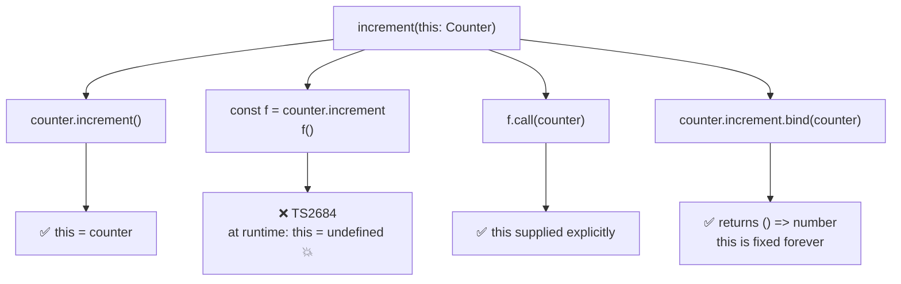

# 04 — The `this` parameter guards detached methods

Demo: `npm run playground ex04__this-param`

This expands `### Typing \`this\`` in `04-functions/LESSON.md`. It was
prompted while working on exercise 04.

A method's `this` is decided by the **call site**, not by where the
method was written. `counter.increment()` sets `this` to `counter`.

Copy the method into a variable, and the object is gone. `f()` has no
receiver, so `this` is `undefined` and `this.count` crashes.

The fake first parameter `this: Counter` tells TS what the method needs.
Now the bad call is a compile error, not a runtime surprise.



*Caption: the `this` parameter turns "who is calling me?" into a type
check. Only calls that supply a `Counter` as `this` compile.*

## Expected type error

```text
TS2684: The 'this' context of type 'void' is not assignable to method's 'this' of type 'Counter'.
```

It points at `f()`. The demo wraps that call in `try/catch` so the rest runs.

## Output

```text
counter.increment()    -> 1
f() detached          -> Cannot read properties of undefined (reading 'count')
f.call(counter)       -> 2
bound()               -> 3
```

The count keeps rising because `call` and `bind` both reach the same object.

## Cheat sheet

| Call | `this` at runtime | TS verdict |
| --- | --- | --- |
| `counter.increment()` | `counter` | ✅ |
| `f()` (detached) | `undefined` | ❌ TS2684 |
| `f.call(counter)` | `counter` | ✅ |
| `bound()` from `.bind(counter)` | `counter` | ✅ typed `() => number` |

## Gotchas

- `this` is not a real parameter. It is erased, and `increment.length` is 0.
- Without the `this: Counter` annotation in the interface, `f()` would
  compile and only crash at runtime.
- Arrow functions have no own `this`, so they can't declare a `this`
  parameter. See `### Arrow functions and lexical \`this\`; \`this: void\``.
