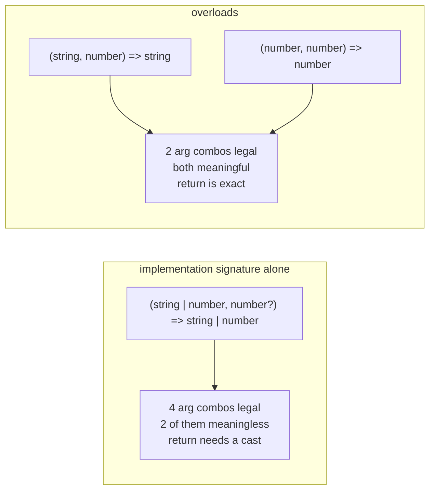

# 04 — Why overloads? What the implementation signature alone loses

Demo: `npm run playground ex04__why-overloads`

This expands `### Union parameter or overloads?` in
`04-functions/LESSON.md`. It was prompted by exercise 04, but uses a
different function (`join`) with the same shape as `makeDate`.

**What only this demo shows:** the *cost* of skipping overloads. Same
body twice. Version A has only the wide signature. Version B adds two
overloads on top. Compare what callers can do.

Version A, `joinLoose`, says "string or number in, string or number
out". It never says *which* goes with which.

So `joinLoose('ab', 2)` is typed `string | number`. You know it's a
string. TS doesn't. You need a cast at every call site.

Version A also says `times` is optional for everyone. That lets in calls
the API never meant to offer.



*Caption: overloads shrink the set of legal calls to the ones that make
sense, and give each one an exact return type.*

The four combos on the left are `('ab')`, `('ab', 2)`, `(3)` and
`(3, 2)`. The two without `times` are the meaningless ones.

## Output

```text
{ l1: 'abab', l1ok: 'ABAB', j1: 'abab', j1ok: 'ABAB', j2: 6 }
```

Same runtime values both ways. Overloads change **types only**.

## Cheat sheet

| | A: implementation only | B: with overloads |
| --- | --- | --- |
| type of `f('ab', 2)` | `string \| number` | `string` |
| `.toUpperCase()` on it | ❌ TS2339 on `string \| number`, needs `as string` | ✅ no cast |
| type of `f(3, 2)` | `string \| number` | `number` |
| `f('ab')` (no `times`) | ✅ compiles | ❌ TS2554 Expected 2 arguments, but got 1 |
| legal call shapes | 4 | 2 |

## Related demos

| Demo | The one thing it adds |
| --- | --- |
| `ex04__overloads` | the basic before/after, and overloads by arity |
| `ex04__overloads2` | the two rules behind TS2394 and TS2769 |
| `ex04__overload-forms` | where overloads can be written |

## Gotchas

- The demo has no type errors on purpose. `l1.toUpperCase()` is a
  comment, and `join('ab')` sits under `// @ts-expect-error`. Remove
  either to see the error.
- Arity errors on an overloaded function name the overloads, not the
  implementation. `times` is required because **both** overloads require it.
- If every overload returns the same type, you don't need overloads. A
  union parameter is simpler and also accepts a union argument.
