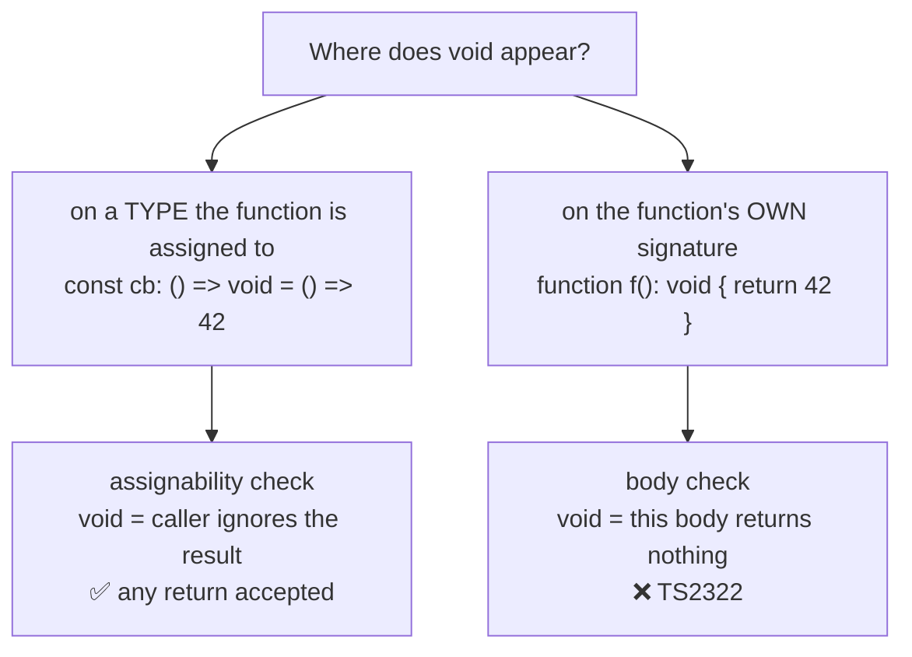

# 04 — The `void` return quirk: q1 vs q2

Demo: `npm run playground ex06__void-quirk`

This expands `### The \`void\` return quirk` in `04-functions/LESSON.md`.
It answers exercise 06's quiz (q1 and q2).

The same word `void` triggers two different checks. Ask: **who** is
being checked, the assignment or the function body?

q1: `const cb: () => void = () => 42` compiles. `void` is on the
**target** type. It means "callers will ignore the result", so any
return type is safe.

q2: `function f(): void { return 42 }` fails. `void` is on f's **own**
signature. Now the body is checked, and `return 42` breaks the promise.



*Caption: same word, two checks. On a target type it's lenient; on your
own signature it's strict.*

## Output

```text
cb() at runtime returns: 42
```

The 42 is really there at runtime. The type `void` just hides it.

## Cheat sheet

| Code | Where is the annotation? | Result |
| --- | --- | --- |
| `const cb: () => void = () => 42` | target type | ✅ (q1) |
| `function f(): void { return 42 }` | own signature | ❌ TS2322 (q2) |
| `const g = (): void => 42` | own signature (arrow) | ❌ TS2322 |
| `const s: () => undefined = () => 42` | target type, but `undefined` | ❌ TS2322 |

## Gotchas

- The three errors sit under `// @ts-expect-error`, so the demo
  typechecks clean.
- The leniency is special to `void`. `() => undefined` gets no such pass.
- This is why exercise 06's `forEachNumber(items, n => result.push(n * 2))`
  compiles. `push` returns a number, but `visit` is typed `=> void`.
- `const got = cb()` is typed `void`. If you need the value, type the
  callback's return as something real.
