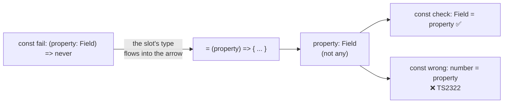

# 05 — An unannotated arrow parameter is typed by its `const`

Demo: `npm run playground contextual-param`

This supports "Assertions need an explicit annotation — TS2775" in
`05-unions-narrowing/LESSON.md`, where the type goes on the `const`. It
came from checkpoint 5's `throwPropertyError`.

The question was: in
`const fail: (property: Field) => never = (property) => { ... }`, the
arrow's `property` has no annotation. Is it `any`?

No. The arrow is written **into a slot** whose type is already known.
TypeScript copies the parameter type from that slot. This is called
*contextual typing*.



*Caption: the annotation on the `const` types both the variable and the
arrow's parameters. You write the type once.*

## How the demo proves it

Two lines carry `@ts-expect-error`. The demo compiles cleanly, so both
errors are real:

- `const wrong: number = property` — TS2322. If `property` were `any`,
  this would compile.
- `fail('nope')` — TS2345: `'nope'` is not a `Field`.

At runtime both calls throw, and the demo catches them:

```text
fail('user') -> user user user
fail('nope') -> nope nope nope (types are erased; runtime does not check)
```

## Cheat sheet

| How it's written | Type of `p` |
| --- | --- |
| `const f: (p: Field) => never = (p) => ...` | `Field` (contextual) |
| `const f = (p: Field): never => ...` | `Field` (annotated on the arrow) |
| `const f = (p) => ...` | ❌ TS7006: implicitly `any` |
| `[...].map((p) => ...)` | the element type (contextual from `map`) |

## Gotchas

- Contextual typing is why callbacks to `map`, `filter` and event
  handlers rarely need annotations.
- Putting the type on the `const` also matters for narrowing: a call to
  `fail(...)` only narrows when `fail` has an explicit type. See
  `cp__never-call-narrowing.md`.
- `'nope'` still reached the function at runtime. Types are erased;
  untrusted input needs a runtime check (an assertion function).
