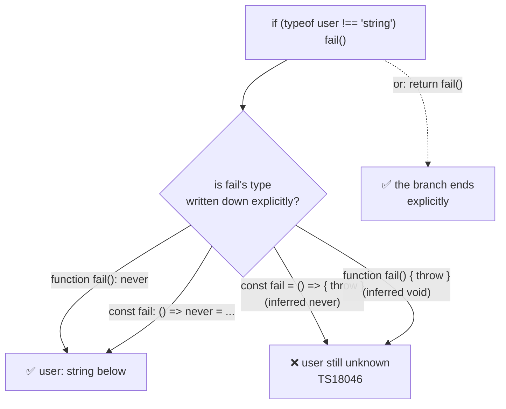

# 05 — When does calling a throwing helper narrow?

Demo: `npm run playground never-call-narrowing`

This expands "Assertions need an explicit annotation — TS2775" in
`05-unions-narrowing/LESSON.md`. The same rule applies to helpers that
return `never`. It came from checkpoint 5's
`if (!isString(user)) throwPropertyError('user')`.

After `if (bad) fail()`, the compiler should know `bad` is false below.
It only knows if it is sure `fail()` **never returns**. And it only
trusts that from an **explicit** type.



*Caption: an inferred `never` is not enough. The compiler needs `never`
in a written annotation, or an explicit `return`.*

## The five cases

| Case | Helper | Inferred return | Narrows after the call? |
| --- | --- | --- | --- |
| A | `const failA = () => { throw }` | `never` | ❌ TS18046 |
| B | `const failB: () => never = ...` | — (annotated) | ✅ |
| C | `function failC(): never` | — (annotated) | ✅ |
| D | `function failD() { throw }` | `void` | ❌ TS18046 |
| E | A's helper, but `return failA()` | `never` | ✅ |

The type check prints exactly two errors, for A and D:

```text
cp__never-call-narrowing.ts(15,10): error TS18046: 'user' is of type 'unknown'.
cp__never-call-narrowing.ts(43,10): error TS18046: 'user' is of type 'unknown'.
```

At runtime all five print `ADA`. The difference is only in the checker.

## Gotchas

- A and D look the same but infer different types. The demo's
  `InferredA` is `never`; `InferredD` is `void`. Hover them to see.
- Why the rule? The compiler decides narrowing while it is still
  building types. Reading a written annotation is cheap. Inferring a
  body first is not, so it doesn't.
- This is the same rule as TS2775 for assertion functions. There it's an
  error. Here the narrowing silently doesn't happen.
- Your checkpoint got it right: `const throwPropertyError: (property:
  Field) => never = ...`. See `cp__contextual-param.md` for its
  parameter.
