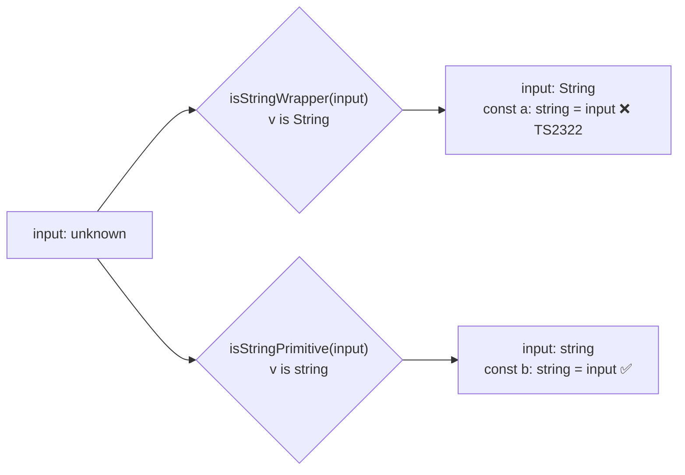
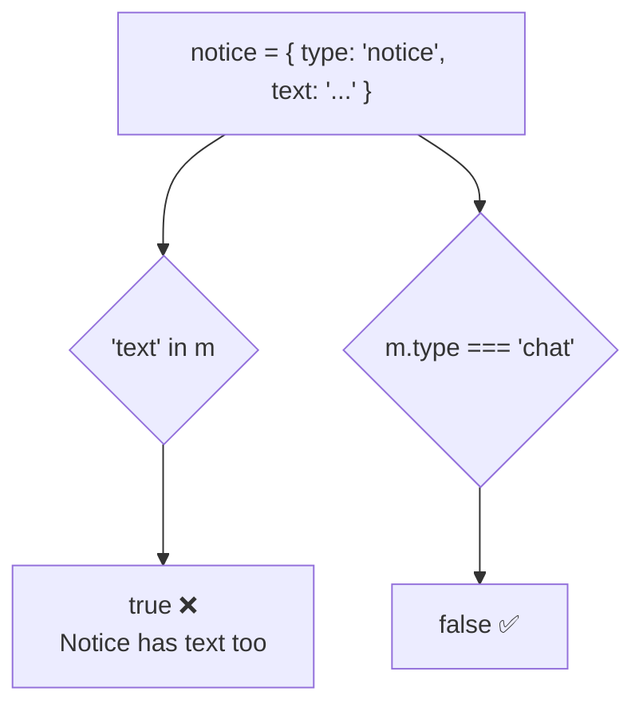

# 05 — Checkpoint 5 review notes

Demo: `npm run playground unions-review`

These are the review points from checkpoint 5 (`checkpoint.ts`, the
chat-message pipeline). They belong with "The compiler trusts your
predicate" in `05-unions-narrowing/LESSON.md`: in each one, the code
runs, but a type says something slightly untrue.

The type check prints two errors on purpose, and the run prints two
lines:

```text
cp__unions-review.ts(13,9): error TS2322: Type 'String' is not assignable to type 'string'.
cp__unions-review.ts(29,3): error TS18046: 'user' is of type 'unknown'.
isChatByField(notice) -> true
isChatByTag(notice)   -> false
```

## 1. `String` vs `string`

`v is String` narrows to the **wrapper object** type. It is not the
primitive. Assigning the result to a `string` fails with TS2322.



*Caption: same runtime check, different promise. Capital `String` is
almost never what you mean.*

Your ex01 `lenExample` has the same slip: `Set<String>`.

## 2. A throwing arrow with no annotation doesn't narrow

`const throwErr = () => { throw ... }` infers `never`, but the compiler
won't use an inferred `never` for narrowing. So `demoA` errors (TS18046)
and `demoB` (annotated `() => never`) is fine. Full story in
`cp__never-call-narrowing.md`.

## 3. Narrow by the tag, not by a field



*Caption: `text` lives on both `Chat` and `Notice`, so it proves nothing.
The tag is the one field built to tell variants apart.*

Both predicates promise `m is Chat`. The compiler trusts both. Only one
tells the truth.

## Cheat sheet

| Point | Wrong | Right | Symptom |
| --- | --- | --- | --- |
| 1 | `v is String` | `v is string` | TS2322 where you use it |
| 2 | `const f = () => { throw }` | `const f: () => never = ...` or `function f(): never` | TS18046: no narrowing after `f()` |
| 3 | `'text' in m` | `m.type === 'chat'` | wrong answer at runtime, no error |

## Gotchas

- Point 3 is the dangerous one: no error anywhere. A predicate body is
  never checked against its `x is T` promise.
- `'key' in m` is only safe when **exactly one** variant has that key.
- The same rule for primitives everywhere: `string`, `number`,
  `boolean`, never `String`, `Number`, `Boolean`.
