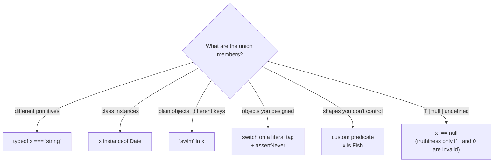
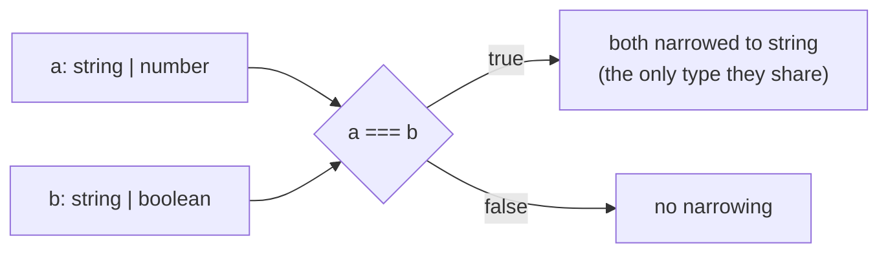

# 05 — A tour of the narrowing tools

Demo: `npm run playground narrowing-tour`

This walks the "Narrowing decision flowchart" in
`05-unions-narrowing/LESSON.md`. Each section of the demo is one branch,
with a real value going through it.

Narrowing means: you run a runtime check, and the compiler shrinks the
type inside the branch. Which check to use depends on **what kind of
members** the union has.

*Caption: pick the check by the kind of members. Each one is a runtime
test the compiler understands.*

## What the demo prints

| Section | Check | Output |
| --- | --- | --- |
| 1 | `typeof id === "string"` | `ABC 3.14` |
| 2 | `when instanceof Date` | `date 2026 regex a+b` |
| 3 | `"swim" in pet` | `splash flap` |
| 4 | `switch (s.kind)` + `assertNever` | `3.14 9` |
| 5 | `pets.filter(isFish)` | `[ 'splash' ]` |
| 6 | `if (msg)` | `HI (nothing) (nothing)` |
| 7 | `a === b` | `XX different` |

## Two branches worth a second look

*Caption: equality narrows **both** sides to their overlap. If `a === b`,
they must be the same type, and `string` is the only one they share.*

Truthiness (section 6) is the risky one. `shout("")` prints
`(nothing)`, the same as `shout(null)`. The empty string is falsy, so it
falls into the "missing" branch.

## Gotchas

- Section 6 is the *falsy ≠ missing* bug from your NOTES (`||` vs `??`).
  If `''` or `0` are valid values, use `msg !== null`, not `if (msg)`.
- `typeof` cannot tell objects apart: arrays, `Date`, `null` and plain
  objects are all `'object'`. That's why sections 2–5 exist.
- Section 5's predicate is the only one that narrows a whole array.
  See `ex07__predicate-wrapper.md`.
