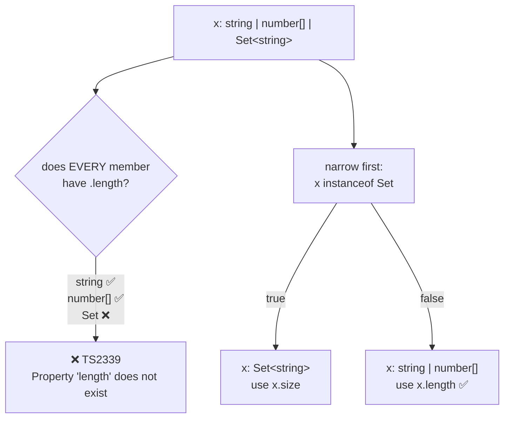

# 05 — Only common members before narrowing

Demo: `npm run playground union-common-members`

This expands the "Only common members before narrowing" section of
`05-unions-narrowing/LESSON.md`. It came up in ex01 (`len`).

A union `A | B | C` says "one of these, and I don't know which". So the
compiler only lets you use members that **every** part has.

`string` has `.length`. `number[]` has `.length`. `Set<string>` does not.
It counts with `.size`. So `x.length` on all three is an error.

*Caption: before narrowing, you only get the overlap. Narrow away the odd
one out, and the rest share `.length` again.*

The demo runs anyway, so you can see the runtime side:
`size: 2` and `length: undefined`. A `Set` really has no `length`. The
error was not fussiness — it caught a real `undefined`.

## Cheat sheet

| Type of `x` | `x.length` | `x.size` |
| --- | --- | --- |
| `string \| number[]` | ✅ both have it | ❌ |
| `string \| number[] \| Set<string>` | ❌ TS2339 | ❌ TS2339 |
| after `x instanceof Set` (true branch) | ❌ | ✅ |
| after `x instanceof Set` (false branch) | ✅ | ❌ |

## Gotchas

- Expected type error: `TS2339: Property 'length' does not exist on type
  'string | Set<string> | number[]'`. That is the point of the demo.
- `(s as any).length` compiles and gives `undefined`. `as any` turns the
  check off; it does not make the member exist.
- Write `Set<string>`, not `Set<String>`. Capital `String` is the wrapper
  object type, not the primitive. Your ex01 `lenExample` used
  `Set<String>`; see `cp__unions-review.md` for why that bites.
- ex04's `sizeOf` is the same idea with only two members. See
  `ex04__sizeof-variants.md` for three ways to narrow it.
