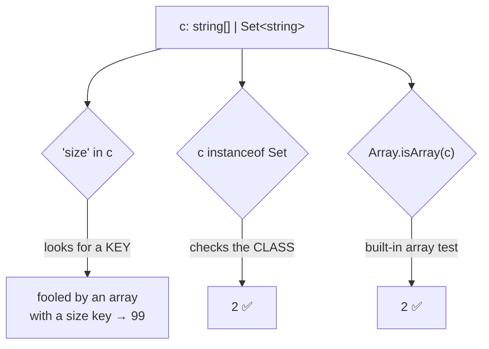

# 05 — Three ways to tell `string[]` from `Set<string>`

Demo: `npm run playground sizeof-variants`

This expands the `in` and `instanceof` narrowing sections of
`05-unions-narrowing/LESSON.md`. It came from ex04's `sizeOf`.

All three checks narrow `string[] | Set<string>` correctly. The compiler
is happy with each. They differ in **what evidence** they look at at
runtime.



*Caption: `in` trusts any object that has the key. `instanceof` and
`Array.isArray` ask what the object really is.*

The demo builds a sneaky array with `Object.assign(['a', 'b'], { size: 99 })`.
It prints:

```text
in:          99
instanceof:  2
isArray:     2
```

## Cheat sheet

| Check | Evidence | Narrows to | Fooled by extra keys? | Best for |
| --- | --- | --- | --- | --- |
| `'size' in c` | a key exists | `Set<string>` | yes | plain object types with different keys |
| `c instanceof Set` | prototype chain | `Set<string>` | no | class instances |
| `Array.isArray(c)` | built-in array test | `string[]` | no | anything vs. arrays |

## Gotchas

- `in` is fine when you **designed** the shapes (ex04's `Car` vs `Boat`).
  With built-in classes, prefer `instanceof` or `Array.isArray`.
- The `as string[]` cast is what hides the extra `size` key from the
  compiler. Casts make runtime and types disagree.
- `instanceof` fails across realms (an array from an iframe or a
  `vm` context). `Array.isArray` does not. That's why it exists.
