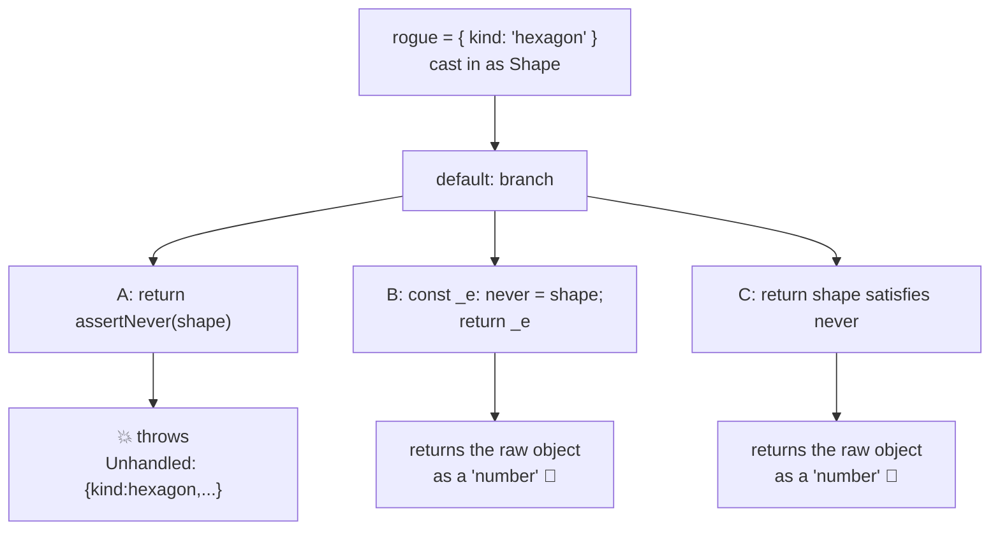

# 05 — Three exhaustive switches: `assertNever`, inline `never`, `satisfies never`

Demo: `npm run playground exhaustive-inline-never`

This expands "Exhaustiveness with `never`" in
`05-unions-narrowing/LESSON.md`. It reuses the `Shape` and `assertNever`
you wrote in ex06.

After every `case` is handled, `shape` in `default` has type `never`.
All three styles pin that fact. Forget a case and all three stop
compiling. The difference is only what they do **at runtime** if a bad
value sneaks in anyway.



*Caption: all three are equal at compile time. Only `assertNever` is loud
at runtime; the other two quietly return garbage.*

Demo output for the rogue value:

```text
A rogue : Unhandled: {"kind":"hexagon","side":3}
B rogue : { kind: 'hexagon', side: 3 }
C rogue : { kind: 'hexagon', side: 3 }
```

## Cheat sheet

| Style | Error if a case is missing | Bad value at runtime | Needs a helper? |
| --- | --- | --- | --- |
| A: `return assertNever(shape)` | TS2345 (argument not assignable to `never`) | throws with the value in the message | yes |
| B: `const _e: never = shape` | TS2322 (not assignable to `never`) | returns the object, silently | no |
| C: `shape satisfies never` | TS1360 (does not satisfy `never`) | returns the object, silently | no |

Error codes checked by deleting a case in a scratch file. Style C also
adds a TS2322 on the `return`, because the expression keeps its real type.

## Gotchas

- Types are erased. A cast (`as unknown as Shape`), a JSON payload, or a
  plain-JS caller can hand you a value no `case` matches.
- B and C return a non-number from a function typed `number`. The bug
  shows up later, far from the switch. Prefer A at system edges.
- B and C are fine for pure, internal code where the compile-time check
  is all you want and you can't afford a helper import.
- Try it: comment out the `'ellipse'` case in any style and run the demo.
