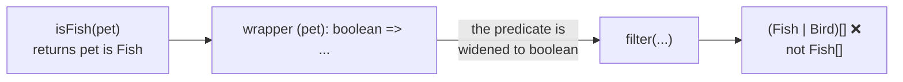

# 05 — Before TS 5.5: an arrow wrapper lost the predicate

Demo: `npm run playground predicate-wrapper-old`

This is the "before" half of "Inferred type predicates (TS 5.5+)" in
`05-unions-narrowing/LESSON.md`. The "after" half is
`ex07__predicate-wrapper.md`.

The one thing this demo shows: a single `: boolean` annotation on the
callback is enough to throw the narrowing away. That is exactly what
every TS version before 5.5 inferred for `(pet) => isFish(pet)`.

*Caption: a predicate is still a boolean underneath. Once the wrapper's
type says `boolean`, the "is Fish" part is gone for good.*

## How the demo proves it

`const checkB: Fish[] = b` carries `@ts-expect-error`. The demo compiles
cleanly, which means the error really happens. Without the marker it is
TS2322: `(Fish | Bird)[]` is not assignable to `Fish[]`.

At runtime it prints `[ 'Nemo' ]`. The filtering is correct. Only the
type is too wide.

## Old TS vs new TS

| Code | TS < 5.5 | TS ≥ 5.5 (this course: 5.9) |
| --- | --- | --- |
| `filter(isFish)` | `Fish[]` | `Fish[]` |
| `filter((pet) => isFish(pet))` | `(Fish \| Bird)[]` | `Fish[]` |
| `filter((pet): boolean => isFish(pet))` | `(Fish \| Bird)[]` | `(Fish \| Bird)[]` |
| `filter((pet): pet is Fish => isFish(pet))` | `Fish[]` | `Fish[]` |

## Gotchas

- You will meet older code full of `(x): x is T => ...` wrappers. They
  were needed then. In 5.5+ you can usually drop the annotation.
- Passing the predicate directly (`filter(isFish)`) worked in every
  version. It is still the clearest form.
- The demo simulates old TS with `: boolean`. It does not run an old
  compiler.
