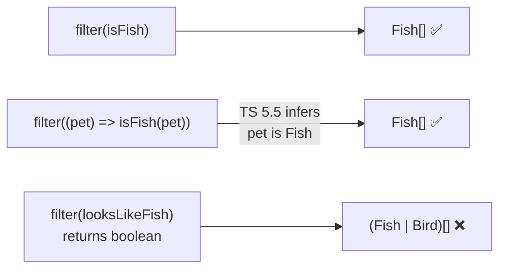

# 05 — Wrapping a predicate in an arrow keeps the narrowing (TS 5.5+)

Demo: `npm run playground predicate-wrapper`

This expands "Inferred type predicates (TS 5.5+)" in
`05-unions-narrowing/LESSON.md`. It came from ex07's `swimmers`.

You wrote `pets.filter(isFish)`. A natural question: what about
`pets.filter((pet) => isFish(pet))`? Does the wrapper lose the
`pet is Fish`?

Since TS 5.5: no. The compiler **infers** a predicate for the arrow.
This demo shows the modern behavior. Its sibling,
`ex07__predicate-wrapper-old.md`, shows what used to happen.

*Caption: what matters is the callback's **type**, not how it is written.
A declared `boolean` return throws the knowledge away.*

## How the demo proves it

The demo uses **type probes**: lines that only compile if the type is
right.

- `const checkB: Fish[] = b` compiles, so `b` is `Fish[]`.
- `const checkC: Fish[] = c` is marked `@ts-expect-error`. Without the
  marker it is TS2322: `(Fish | Bird)[]` is not assignable to `Fish[]`.
- `const probe: (pet: Fish | Bird) => pet is Fish = wrapper` compiles,
  so the inferred type of `wrapper` really is a predicate.

At runtime all three filters print `[ 'Nemo' ]`. Only the types differ.

## Cheat sheet

| Callback | Its type | `filter` result |
| --- | --- | --- |
| `isFish` | `(pet) => pet is Fish` | `Fish[]` |
| `(pet) => isFish(pet)` | inferred `(pet) => pet is Fish` | `Fish[]` |
| `(pet): boolean => isFish(pet)` | `(pet) => boolean` | `(Fish \| Bird)[]` |
| `looksLikeFish` | `(pet) => boolean` | `(Fish \| Bird)[]` |

## Gotchas

- Inference needs "true means Fish, false means not Fish". Add an extra
  condition (`isFish(pet) && pet.name !== ''`) and it gives up.
- An explicit return type always wins over inference. `: boolean` turns
  the predicate off. See `ex07__predicate-wrapper-old.md`.
- When inference gives up, write it yourself:
  `(pet): pet is Fish => isFish(pet) && pet.name !== ''`.
