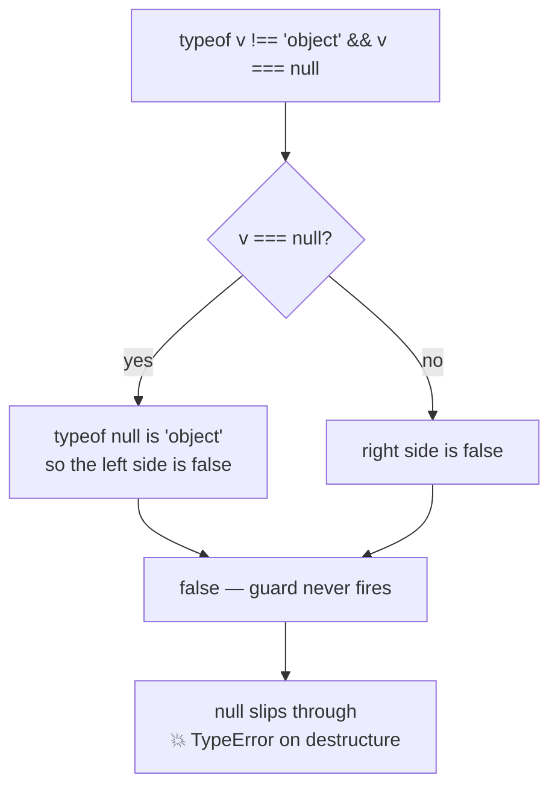

# 05 — A null guard that never fires (`&&` vs `||`)

Demo: `npm run playground assert-null-guard`

This expands "Never cast the input to the target type inside a guard" in
`05-unions-narrowing/LESSON.md`. That section's guard starts with
`typeof value !== 'object' || value === null`. This demo shows why it
must be `||`.

An early draft of ex08's `assertIsUser` used `&&`. It looked right, and
the type checker accepted it. But it can **never** be true.

*Caption: the only value where `v === null` is true has
`typeof === 'object'`. The two halves can't both be true, so `&&` is
always `false`.*

The fix is De Morgan. "Reject unless it's a non-null object" is
`!(typeof v === 'object' && v !== null)`, which is
`typeof v !== 'object' || v === null`.

## What the demo prints

| Value | `typeof` | `&&` guard fires | `\|\|` guard fires |
| --- | --- | --- | --- |
| `null` | `object` | false | true |
| `"Ada"` | `string` | false | true |
| `42` | `number` | false | true |
| `undefined` | `undefined` | false | true |
| `{}` | `object` | false | false |
| `[]` | `object` | false | false |
| `{"name":"Ada","age":1}` | `object` | false | false |

Then, on `null`, the next line blows up:
`TypeError: Cannot destructure property 'name' of 'null' as it is null.`

## Gotchas

- `typeof null === 'object'`. It's a 30-year-old JavaScript bug that can
  never be fixed. Always pair the `typeof` check with `!== null`.
- The compiler did not warn. A guard is a runtime check; TypeScript
  trusts that you wrote it correctly. Test guards with `null`.
- Arrays pass the object guard too (`[]` row). Later field checks
  (`typeof name !== 'string'`) are what reject them.
