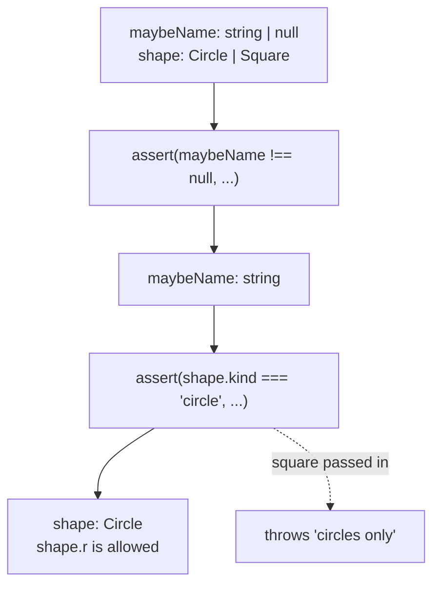

# 05 — `asserts condition` narrows whatever expression you pass

Demo: `npm run playground asserts-condition-narrows`

This expands the `asserts condition` half of "Assertion functions" in
`05-unions-narrowing/LESSON.md`. It is ex08's `assert` in action.

`ex08__predicate-vs-assertion.md` uses `asserts pet is Fish`, which
names a **type**. This demo shows the other form, `asserts condition`.
It names no type at all. The compiler reads the **expression** at the
call site instead.



*Caption: each `assert(...)` acts like `if (!(expr)) throw`. Whatever
`expr` would narrow inside an `if`, it narrows after the call.*

One generic `assert` handles a null check **and** a discriminant check.
You don't write a separate assertion per type.

Demo output:

```text
UNIT: 3.141592653589793
threw: circles only
BIG: 12.566370614359172
```

The last line comes from `areaWithIf`. It does the same job with plain
`if (...) throw`. Same narrowing, same result.

## Cheat sheet

| Form | Signature | Narrows | Reusable for |
| --- | --- | --- | --- |
| `asserts condition` | `assert(cond: unknown, msg): asserts cond` | the expression you pass | any check |
| `asserts x is T` | `assertIsUser(v: unknown): asserts v is User` | `x` to `T` | one type |
| `if (...) throw` | none | same as `asserts condition` | inline only |

## Gotchas

- The `!` non-null operator would also silence `maybeName.toUpperCase()`.
  But `!` checks nothing at runtime. `assert` checks *and* narrows.
- Node's built-in `assert` from `node:assert` has this same
  `asserts value` signature.
- The narrowing only reaches code after the call in the **same** scope.
  A callback defined earlier doesn't see it.
