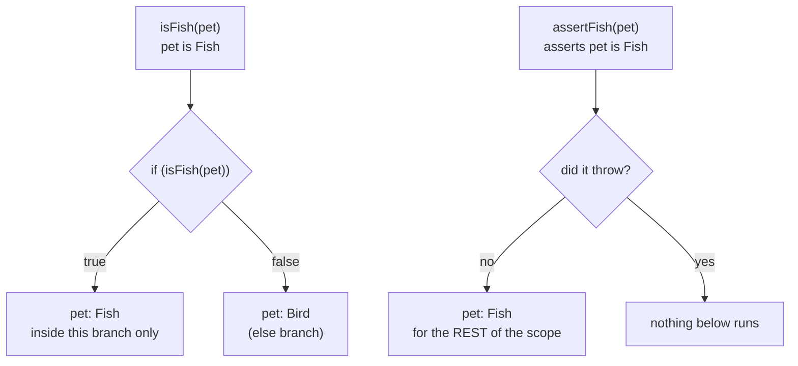

# 05 — Predicate vs assertion: same check, two signatures

Demo: `npm run playground predicate-vs-assertion`

This expands "Assertion functions — `asserts x is T` and `asserts
condition`" in `05-unions-narrowing/LESSON.md`. It came from ex08,
right after ex07's `isFish`.

`isFish` and `assertFish` run the **same** check: `'swim' in pet`. Only
the signature differs. That changes *where* the narrowing lives.

This is the overview demo of the ex08 set. The others zoom in:
`ex08__asserts-condition-narrows.md` (asserting an expression),
`ex08__assert-null-guard.md` (a guard bug), and
`ex08__throw-travels-up.md` (what the throw does).



*Caption: a predicate answers with `true`/`false`, so you branch. An
assertion answers by not throwing, so everything after the call is
narrowed.*

Demo output:

```text
predicate  → splash
predicate  → flap
assertion  → splash
assertion  → threw: Tweety is not a fish
filter     → [ 'Nemo' ]
```

## Cheat sheet

| | Type predicate | Assertion function |
| --- | --- | --- |
| Signature | `(pet) => pet is Fish` | `(pet) => asserts pet is Fish` |
| Returns at runtime | `true` / `false` | `undefined`, or throws |
| Narrowing lives | inside the `if` / `else` | after the call, to end of scope |
| Bird case | `else` branch, you handle it | an `Error` |
| Works with `filter` | ✅ gives `Fish[]` | ❌ (see gotchas) |
| Use when | both outcomes are normal | the bad case is a bug or bad input |

## Gotchas

- `[nemo, tweety].filter(assertFish)` **compiles**. A `void` function
  fits filter's `=> unknown` callback. But the result stays
  `(Fish | Bird)[]`, and it throws on Tweety. Even `[nemo].filter(assertFish)`
  returns `[]`: the assertion returns `undefined`, which is falsy.
- An assertion stored in an unannotated `const` arrow gives TS2775 at the
  call. Write assertions as `function` declarations.
- Neither signature is checked against its body. A wrong body gives
  confidently wrong types ("The compiler trusts your predicate").
