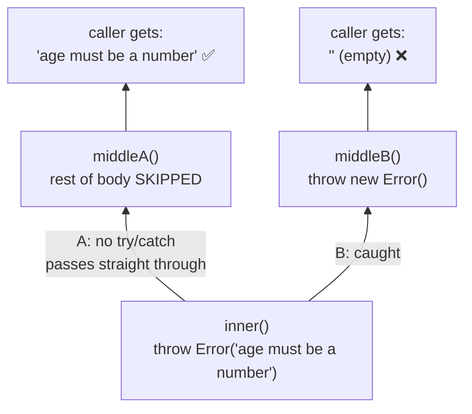

# 05 — How a thrown error travels up the call stack

Demo: `npm run playground throw-travels-up`

This supports "Assertion functions" in `05-unions-narrowing/LESSON.md`:
"it throws, or it returns". It came from ex08, where `assertIsUser`
throws and `greet` calls it.

The other ex08 demos are about types. This one is pure runtime: what
happens to a `throw` in a function that doesn't catch it, and what a
catch-and-rethrow does to the message.



*Caption: an error rises through every function until something catches
it. Catching it and throwing a blank error replaces the useful message
with nothing.*

Demo output, trimmed:

```text
=== Version A (no try/catch) ===
caller received message: "age must be a number"
=== Version B (try/catch + rethrow blank) ===
 middleB: caught "age must be a number", throwing a blank one instead
caller received message: ""
```

`middleA: this line is SKIPPED` never prints. A throw ends the function
right there.

## Cheat sheet

| In the middle function | What the caller sees |
| --- | --- |
| no `try/catch` | the original error, message intact |
| `catch (e) { throw e }` | the original error |
| `catch (e) { throw new Error('ctx', { cause: e }) }` | new message, original kept in `.cause` |
| `catch { throw new Error() }` | an empty message — the info is lost |

## Gotchas

- You don't need `try/catch` just to "pass an error up". Doing nothing
  already does that.
- Catch only where you can add value: recover, or add context with
  `{ cause }`.
- `inner(): never` tells the compiler the function never returns
  normally. Code after a call to it is unreachable.
