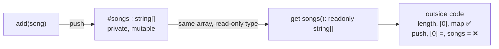

# 06 — Read-only for outsiders, writable inside

Demo: `npm run playground cp__readonly-array`

This expands the `readonly` — write once, and only shallowly section of
`06-classes/LESSON.md`, as used in the checkpoint's `ShapeCollection`.

You want two things at once. The class may push into its list. Callers
may only read it.

One `readonly` keyword can't do both. So split the list into two views
of the same array: a private, mutable field, and a public getter typed
`readonly string[]`.

*Caption: one array, two types. Inside the class it is a normal
`string[]`; the getter hands out the same array under a type with no
mutating methods.*

## Which `readonly` does what

This is the split from your checkpoint note in `NOTES.md`.

| You write | What it locks | Who is locked out | Class can still push? |
| --- | --- | --- | --- |
| `readonly songs: string[]` | the **property** (no `songs = ...`) | everyone, after the constructor | ✅ (and so can outsiders) |
| `songs: readonly string[]` | the **contents** (no `push`, no `[i] =`) | everyone, the class too | ❌ |
| `#songs: string[]` + `get songs(): readonly string[]` | contents, for outsiders only | outside code | ✅ |

## What the run shows

| Line | Output |
| --- | --- |
| `p.songs.length` | `2` |
| `p.songs[0]` | `Hey Jude` |
| `p.songs.map(upper)` | `[ 'HEY JUDE', 'LET IT BE' ]` |
| after `(p.songs as string[]).push("Sneaky")` | `[ 'Hey Jude', 'Let It Be', 'Sneaky' ]` |

The three commented-out lines are the compile errors you'd get:

| Attempt | Error |
| --- | --- |
| `p.songs.push("Yesterday")` | TS2339 — `push` does not exist on `readonly string[]` |
| `p.songs[0] = "Yesterday"` | TS2542 — index signature only permits reading |
| `p.songs = []` | TS2540 — `songs` is a read-only property (getter, no setter) |

## Gotchas

- `readonly string[]` is a compile-time type. The getter returns the
  real array, so a cast (`as string[]`) gets past it and mutates the
  private list. The last output line proves it.
- Want real protection at runtime? Return a copy (`[...this.#songs]`) or
  freeze it. That costs a copy per read.
- A getter with no setter is already read-only. You never write
  `readonly` on it.
- See [`cp__readonly-check.md`](./cp__readonly-check.md): the same idea,
  but as a guard on the real checkpoint class.
