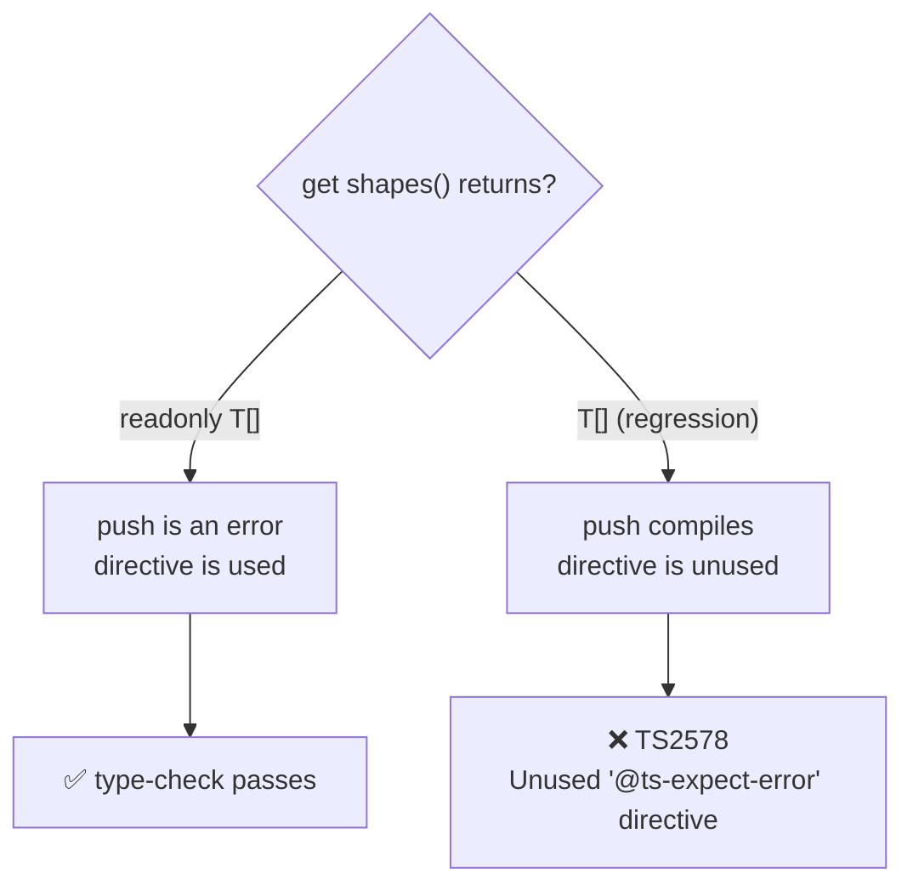

# 06 — Pin a type rule with `@ts-expect-error`

Demo: `npm run playground cp__readonly-check`

This guards the checkpoint's `ShapeCollection.shapes` getter. It belongs
with the `readonly` — write once, and only shallowly section of
`06-classes/LESSON.md`.

[`cp__readonly-array`](./cp__readonly-array.md) teaches the pattern on a
toy `Playlist`. This file does one different thing: it imports the
**real** `ShapeCollection` from `06-classes/checkpoint_06.ts` and fails
type-checking if the pattern ever breaks.

The trick is `// @ts-expect-error`. It says "the next line must be a
type error". If the line stops being an error, the directive itself
becomes one: TS2578, unused `@ts-expect-error`.

*Caption: the directive turns "this must not compile" into a check. A
regression to a mutable `T[]` makes the type-check fail.*

## What the run shows

| Step | Output |
| --- | --- |
| type-check | clean (the `push` errors, and the directive expects it) |
| `shapes.length before` | `1` |
| `shapes.length after` | `2` |

## `@ts-expect-error` vs `@ts-ignore`

| Directive | Next line is an error | Next line is fine |
| --- | --- | --- |
| `@ts-expect-error` | silenced | ❌ TS2578: unused directive |
| `@ts-ignore` | silenced | silent (no check at all) |

Use `@ts-expect-error` for "this must not compile" tests. `@ts-ignore`
can never fail, so it proves nothing.

## Gotchas

- The directive only silences the compiler. The `push` still runs, so
  the length goes from `1` to `2`. Same lesson as the cast in
  `cp__readonly-array`: `readonly T[]` is a type, not a lock.
- The directive covers only the **next line**, and any error there
  counts. A typo on that line would also "pass". Keep the line minimal.
- The path is `../../06-classes/checkpoint`: up out of
  `playground/06-classes/`, then up out of `playground/`.
