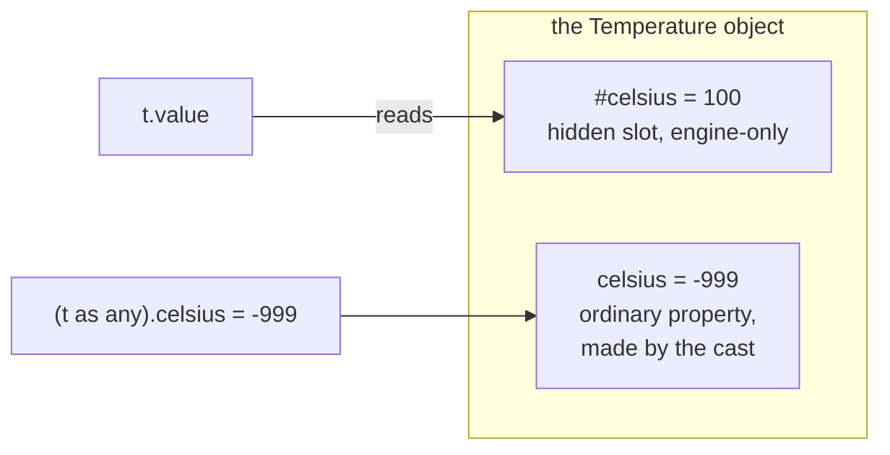

# 06 — `#private` survives runtime, `private` doesn't

Demo: `npm run playground ex03__private-fields`

This expands the `#private` — privacy the engine enforces section of
`06-classes/LESSON.md`. It came up in ex03, where `Temperature` stores a
private `celsius`.

`private celsius` is a TypeScript rule. After compiling, it is a normal
property named `celsius`. `#celsius` is JavaScript syntax. The engine
itself hides it.

The demo pokes at the object with `(t as any).celsius = -999`. That does
**not** touch `#celsius`. It creates a brand new property.

*Caption: `#celsius` and `celsius` are two different keys. The cast can
only reach the ordinary one, so `t.value` still reads 100.*

## What the run shows

| Line | Output | Why |
| --- | --- | --- |
| `t.fahrenheit` | `212` | getter: `100 * 1.8 + 32` |
| `t.value` | `100` | the cast never reached `#celsius` |
| `Object.keys(t)` | `[ 'celsius' ]` | only the cast's property; `#celsius` is not a key |

## `private` vs `#`

| | `private celsius` | `#celsius` |
| --- | --- | --- |
| Checked by | TypeScript only | the JS engine |
| `t.celsius` outside the class | ❌ TS2341 | no such property |
| `(t as any).celsius` | reads/writes the real value | makes an unrelated property |
| Shows in `Object.keys` / `JSON.stringify` | yes | no |
| As a parameter property | ✅ `constructor(private celsius: number)` | ❌ TS18009 |

## Gotchas

- The commented `class Bad { constructor(#celsius: number) {} }` fails
  with TS18009: "Private identifiers cannot be used as parameters". So
  `#` costs you the parameter-property shortcut. That is why ex03 asks
  for `private` and keeps a `#` version only as a side note.
- `this['#celsius']` is not the field either. `#celsius` is not a string
  key.
- Pick `private` for "don't use this, it's internal". Pick `#` when the
  value must stay hidden even from `any`, `Object.keys`, and JSON.
